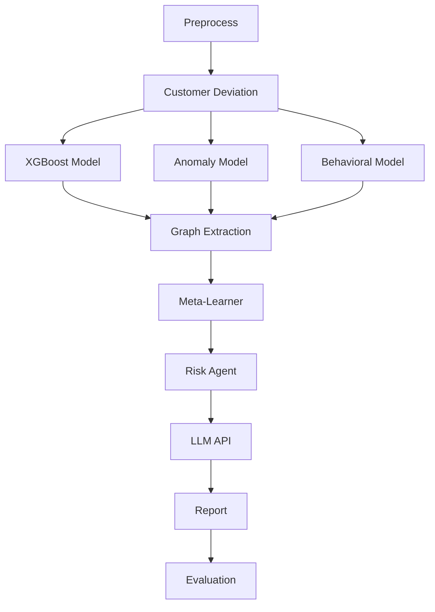

# FINDETECT

**AI-powered Anti-Money Laundering (AML) detection pipeline** that combines multiple machine learning models, customer behavior analysis, transaction graph context, and an LLM-generated explanation layer to score financial transactions and produce audit-ready risk reports.

---

## Table of Contents

1. [Overview](#overview)
2. [Key Features](#key-features)
3. [How It Works](#how-it-works)
4. [Project Structure](#project-structure)
5. [Requirements](#requirements)
6. [Installation](#installation)
7. [Usage](#usage)
8. [Evaluation Results](#evaluation-results)
9. [Configuration](#configuration)
10. [Data & Privacy](#data--privacy)
11. [Limitations & Disclaimer](#limitations--disclaimer)
12. [Contributing](#contributing)
13. [License](#license)
14. [Contact](#contact)

---

## Overview

Financial institutions and regulators must identify suspicious activity across very large volumes of transactions. Rules-based systems generate many false positives, and single-model approaches miss patterns that only appear when several signals are combined.

FINDETECT addresses this by running every transaction batch through a multi-stage pipeline:

- Several independent detection models look at the data from different angles (supervised, unsupervised, and behavioral).
- A **meta-learner** fuses their outputs into one calibrated risk score.
- A **risk agent** and an **LLM** turn the score into a human-readable explanation.
- A final **evaluation** step measures how well the pipeline performed.

The pipeline is orchestrated with [LangGraph](https://github.com/langchain-ai/langgraph), which makes each stage explicit, testable, and easy to extend.

**Intended audience:** compliance analysts, financial institutions, government and regulatory bodies, and developers/students building on the project.

---

## Key Features

- **Multi-model detection**: XGBoost (supervised), anomaly detection (unsupervised), and behavioral modeling run in parallel.
- **Customer deviation analysis**: compares each transaction against the customer's own historical behavior.
- **Graph context extraction**: adds relationship and network features between accounts.
- **Meta-learner fusion**: learns how to weight the individual models instead of relying on fixed rules; includes fusion-weight optimization.
- **Explainable output**: a locally hosted LLM (via Ollama) generates a plain-language rationale for each risk decision, keeping data on-premises.
- **Automated reporting and evaluation**: produces reports and performance metrics at the end of each run.
- **Threshold analysis**: risk scores can be exported and analyzed to choose operating thresholds.
- **Batch processing**: run a single day or all days in a dataset.
- **Web frontend** for viewing results.
- **Local analytical storage** using DuckDB and Parquet for fast processing without a separate database server.

---

## How It Works

The pipeline is defined in `LangGraph.py` as a directed graph with a parallel fan-out and fan-in.



| Stage | Purpose |
|---|---|
| **Preprocess** | Cleans and prepares raw transaction data. |
| **Customer Deviation** | Measures how far each transaction deviates from the customer's normal behavior. |
| **XGBoost / Anomaly / Behavioral models** | Three detection models that run **in parallel** and each produce a risk signal. |
| **Graph Extraction** | Adds network/relationship context between accounts. |
| **Meta-Learner** | Combines all model outputs and graph context into a single fused risk score. |
| **Risk Agent** | Applies decision logic to the fused score. |
| **LLM API** | Generates a natural-language explanation of the risk decision using a local LLM served by Ollama. |
| **Report** | Assembles the final results. |
| **Evaluation** | Computes performance metrics for the run. |

Shared data moves between stages through a custom state object (`AMLPipelineState`), which uses a `merge_dicts` reducer so that parallel model branches can safely write their results without overwriting each other.

---

## Project Structure

```
FINDETECT/
├── frontend/                        # Web interface for viewing results
├── models/                          # Trained models
├── pre_model/                       # Pre-trained / preliminary model artifacts
├── threshold_report/                # Threshold analysis outputs
├── AMLPipelineState.py              # Shared pipeline state (with merge_dicts reducer)
├── config.py                        # Central configuration
├── customer_deviation.py            # Customer behavior deviation logic
├── LangGraph.py                     # Pipeline graph definition and compilation
├── LLM.py                           # LLM integration for explanations
├── main.py                          # Main entry point
├── make_sample.py                   # Generates sample data
├── meta_learner.py                  # Meta-learner model
├── nodes.py                         # Node implementations for each pipeline stage
├── optimize_fusion_weights.py       # Optimizes weights used to fuse model outputs
├── train_meta_learner_fixed.py      # Trains the meta-learner
├── run_full_pipeline.py             # Runs the complete pipeline
├── run_all_days.py                  # Runs the pipeline across all days in the dataset
├── risk_scores_for_threshold_analysis.parquet  # Exported scores for threshold analysis
├── data.duckdb                      # Local DuckDB database
├── requirements.txt                 # Python dependencies
└── README.md
```

---

## Requirements

- Python 3.10 or higher *(update if you require a different version)*
- The packages listed in `requirements.txt`, including LangGraph, XGBoost, and DuckDB
- [Ollama](https://ollama.com) installed and running locally, with a model pulled for the explanation step *(see [Configuration](#configuration))*

---

## Installation

```bash
# 1. Clone the repository
git clone https://github.com/aml-compliance-system/aml-compliance-system.git
cd aml-compliance-system

# 2. Create and activate a virtual environment
python -m venv venv
source venv/bin/activate        # Windows: venv\Scripts\activate

# 3. Install dependencies
pip install -r requirements.txt

# 4. Install Ollama (https://ollama.com) and pull the model used for explanations
ollama pull qwen2.5
```

---

## Usage

### 1. Generate sample data (optional)

```bash
python make_sample.py
```

### 2. Train the meta-learner (if models are not already provided)

```bash
python train_meta_learner_fixed.py
```

### 3. Run the full pipeline

```bash
python run_full_pipeline.py
```

### 4. Run across all days in the dataset

```bash
python run_all_days.py
```

### 5. Use the pipeline programmatically

```python
from LangGraph import app

result = app.invoke({...})  # pass your initial AMLPipelineState input
```

*Replace the input above with the fields your `AMLPipelineState` expects.*

### Output

Each run produces a risk score per transaction, an LLM-generated explanation, a report, and evaluation metrics. Exported scores can be used for threshold tuning (see `threshold_report/`).

---

## Evaluation Results

FINDETECT is evaluated at two levels: each detection model is scored per **transaction**, and the final Risk Agent is scored per **account/day**, which is the level at which a compliance analyst actually reviews alerts. Because the grains differ, the two tables should not be compared row by row.

Suspicious activity is extremely rare in this data (about 0.18% of transactions and 0.53% of account/days), so accuracy is not a useful metric. Precision, recall and F1 on the suspicious class are reported instead.

### Individual models (transaction level)

| Model | Precision | Recall | F1-Score | TP | FP | FN | TN |
|---|---|---|---|---|---|---|---|
| XGBoost | 0.0315 | 0.0476 | 0.0379 | 230 | 7,074 | 4,603 | 2,749,343 |
| Autoencoder (anomaly) | 0.0068 | 0.3296 | 0.0134 | 1,593 | 231,461 | 3,240 | 2,524,956 |
| Behavioral Risk | 0.0717 | 0.0395 | 0.0510 | 191 | 2,472 | 4,642 | 2,753,945 |

Each model captures a different trade-off. The autoencoder finds the most suspicious transactions (highest recall) but raises many false alarms, while the behavioral model is the most precise but misses most cases. No single model is sufficient on its own, which is the reason for the fusion step.

### Final Risk Agent (account/day level)

| Metric | Value |
|---|---|
| Precision | 0.1172 (11.7%) |
| Recall | 0.7462 (74.6%) |
| F1-Score | 0.2026 |
| True Positives | 3,122 |
| False Positives | 23,511 |
| False Negatives | 1,062 |
| True Negatives | 761,380 |

Of 789,075 account/days, the Risk Agent flagged 26,633 (about 3.4%) and caught 3,122 of the 4,184 truly suspicious ones. That is roughly 22 times more precise than reviewing account/days at random (base rate 0.53%), while recovering about three quarters of the suspicious activity.

### Reading these results

- The combined Risk Agent reaches far higher recall (74.6%) than any individual model (at most 33%), which shows the benefit of fusing models and graph context.
- Precision is still low in absolute terms (11.7%), so most alerts are false positives and need human review. Alert volume and precision can be traded off by adjusting the decision threshold (see `threshold_report/`).
- These figures come from one dataset and one configuration. Re-evaluate on your own data before operational use.

---

## Configuration

Settings are managed in `config.py`. Typical values to set include:

- Data paths and database location
- Model and threshold settings
- Ollama model name (default: `qwen2.5`) and server address (by default Ollama listens on `http://localhost:11434`)

Because the LLM runs locally, no API key is required. If you add other secrets or credentials later, store them in environment variables or a local `.env` file excluded through `.gitignore`.

---

## Data & Privacy

Financial data is highly sensitive. When deploying FINDETECT:

- Run it inside your organization's secure environment; data is stored locally in DuckDB/Parquet files.
- The LLM explanation step runs **locally through [Ollama](https://ollama.com)**, so transaction details are not sent to an external API or third-party service. This makes FINDETECT suitable for environments with strict data-residency requirements.
- Do not commit real customer data to the repository. Use `make_sample.py` for demos and testing.
- Follow applicable regulations for your jurisdiction (for example GDPR or local AML/KYC requirements).

---

## Limitations & Disclaimer

- FINDETECT is a **decision-support tool**. It does not replace human compliance analysts or make final determinations of illicit activity.
- Model performance depends on data quality and how closely the data matches the training data. Results should be validated on your own data before operational use.
- LLM-generated explanations are meant to assist review and may contain inaccuracies; they should not be treated as evidence.
- Thresholds should be tuned and approved by your compliance team.

---

## Contributing

Contributions are welcome.

1. Fork the repository
2. Create a feature branch: `git checkout -b feature/your-feature`
3. Commit your changes with clear messages
4. Push the branch and open a Pull Request

Please keep changes focused, and include tests or sample results where possible.

---

## License

This project is licensed under the **MIT License**. See the [LICENSE](LICENSE) file for details.

---

## Contact

**Team:** FINDETECT team SDAA
**Email:** [jawadaljabbar@gmail.com](mailto:jawadaljabbar@gmail.com)
**Repository:** [github.com/aml-compliance-system/aml-compliance-system](https://github.com/aml-compliance-system/aml-compliance-system)
