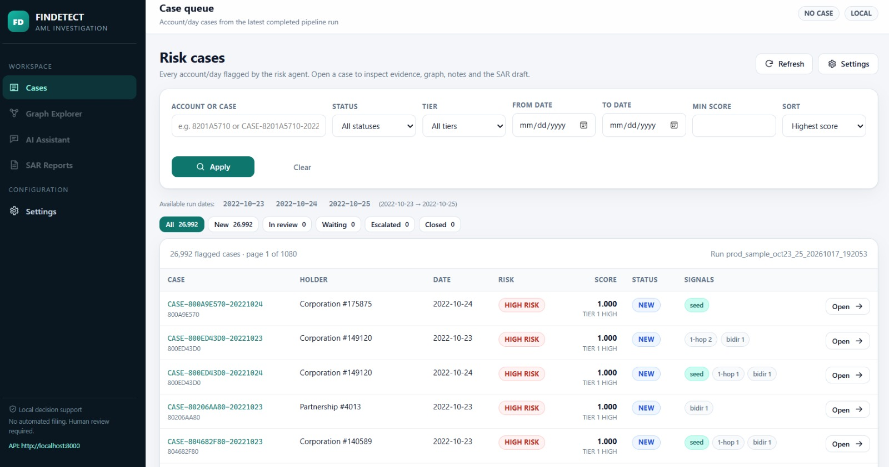
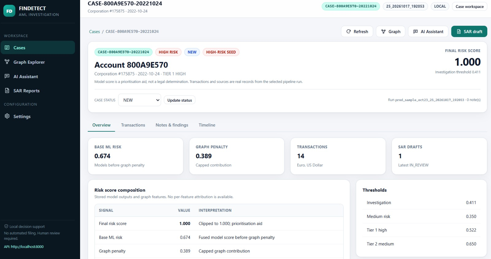
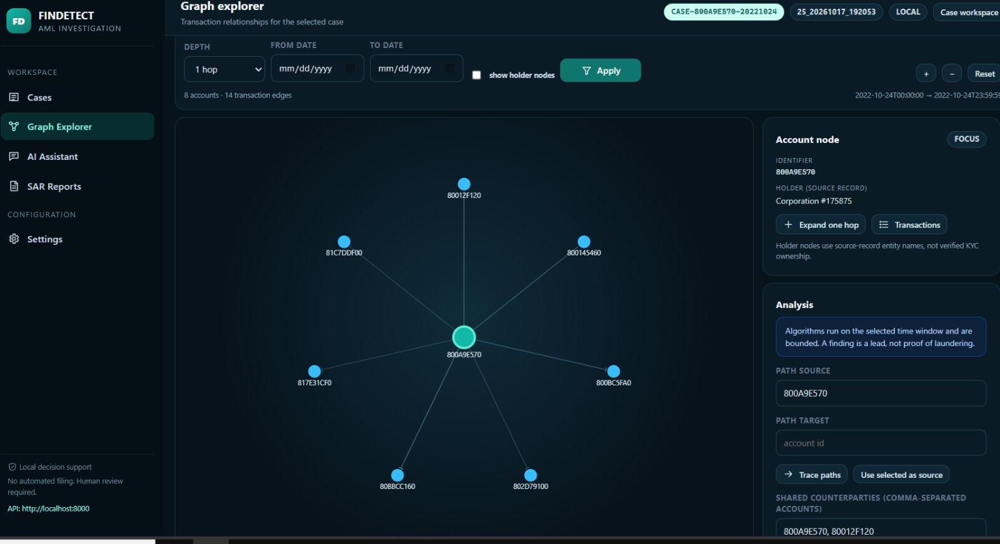
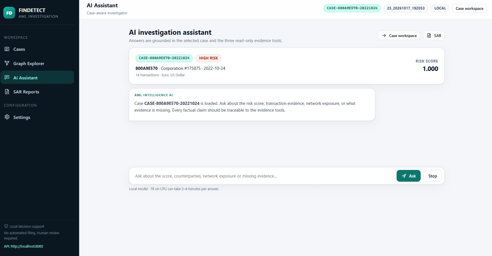
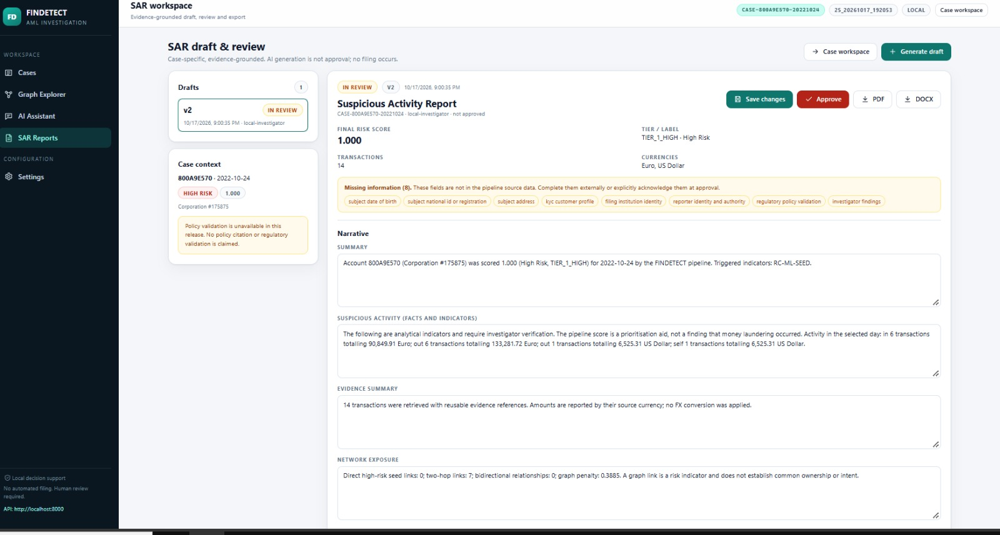
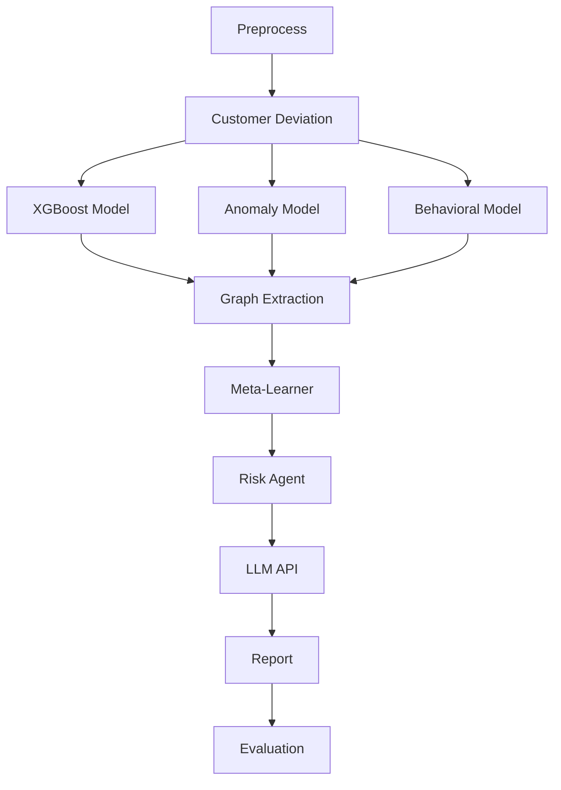

# FINDETECT

**AI-powered Anti-Money Laundering (AML) detection pipeline** that combines multiple machine learning models, customer behavior analysis, transaction graph context, and an LLM-generated explanation layer to score financial transactions and produce audit-ready risk reports.

---

## Table of Contents

1. [Overview](#overview)
2. [Key Features](#key-features)
3. [Screenshots](#screenshots)
4. [How It Works](#how-it-works)
5. [Project Structure](#project-structure)
6. [Requirements](#requirements)
7. [Installation](#installation)
8. [Usage](#usage)
9. [Evaluation Results](#evaluation-results)
10. [Configuration](#configuration)
11. [Data & Privacy](#data--privacy)
12. [Limitations & Disclaimer](#limitations--disclaimer)
13. [Contributing](#contributing)
14. [License](#license)
15. [Contact](#contact)

---

## Overview

Financial institutions and regulators must identify suspicious activity across very large volumes of transactions. Rules-based systems generate many false positives, and single-model approaches miss patterns that only appear when several signals are combined.

FINDETECT addresses this by running every transaction batch through a multi-stage pipeline:

- Several independent detection models look at the data from different angles (supervised, unsupervised, and behavioral).
- A **meta-learner** fuses their outputs into one risk score per account per day. It is a ranking score, not a calibrated probability (see [Limitations](#limitations--disclaimer)).
- A **risk agent** and an **LLM** turn the score into a human-readable explanation.
- A final **evaluation** step measures how well the pipeline performed.

The pipeline is orchestrated with [LangGraph](https://github.com/langchain-ai/langgraph), which makes each stage explicit, testable, and easy to extend.

**Intended audience:** compliance analysts, financial institutions, government and regulatory bodies, and developers/students building on the project.

---

## Key Features

- **Multi-model detection**: XGBoost (supervised), anomaly detection (unsupervised), and behavioral modeling run in parallel.
- **Customer deviation analysis**: compares each transaction against the customer's own historical behavior.
- **Graph context extraction**: adds relationship and network features between accounts.
- **Meta-learner fusion**: learns how to weight the individual models instead of relying on fixed rules; includes fusion-weight optimization.
- **Explainable output**: a locally hosted LLM (via Ollama) generates a plain-language rationale for each risk decision, keeping data on-premises.
- **Automated reporting and evaluation**: produces reports and performance metrics at the end of each run.
- **Threshold analysis**: risk scores can be exported and analyzed to choose operating thresholds.
- **Batch processing**: run a single day or all days in a dataset.
- **Web dashboard**: analysts run the pipeline from the browser, review flagged accounts, and chat with a local AI investigator about each case (FastAPI backend + HTML frontend).
- **Case workspace**: real account/day cases with risk composition, transaction explorer, notes, timeline, graph and SAR in one case context.
- **Interactive graph investigation**: bounded account/transaction graph with time-ordered path tracing, cycle detection, shared counterparties, connected components and evidence references.
- **SAR workflow**: evidence-grounded draft, editing, missing-field validation, human review/approval and PDF/DOCX export. No external filing.
- **Agentic investigator**: the chat LLM can call three read-only evidence tools (`get_account_scores`, `get_transactions`, `get_graph_exposure`), decide what to inspect, and answer with a trace of the evidence it used. See [Agentic AML Investigator](AGENTIC_AI.md).
- **Local analytical storage** using DuckDB and Parquet for fast processing without a separate database server.

---

## Screenshots

The investigator workspace, shown on a real run of the sample dataset (account/day cases from `prod_sample_oct23_25`).

### Case queue



*Every flagged account/day from the latest pipeline run, with search, status, tier, date and score filters. Each row shows the case ID, holder, risk label, score, status and network signals (seed, 1-hop exposure, bidirectional flows).*

### Case workspace



*One case in detail: final risk score against the investigation threshold, base ML risk, graph penalty, transaction count by currency, SAR drafts, and the score composition with the tier thresholds. Tabs lead to transactions, notes and the timeline.*

### Graph explorer



*Bounded transaction graph around the selected account. Nodes can be expanded, and the side panel traces time-ordered money paths, cycles, shared counterparties and connected components. Findings are leads, not proof of laundering.*

### AI investigation assistant



*Case-aware chat running on a local model. Answers are grounded in the three read-only evidence tools, and each answer shows which tools it used. If the model is unavailable, an offline evidence memo is shown instead.*

### SAR draft and review



*Evidence-grounded draft with an editable narrative, a list of missing information, activity by currency and transaction evidence. A draft moves from draft to review to approval by a human, with PDF and DOCX export. Nothing is filed externally.*

---

## How It Works

The pipeline is defined in `LangGraph.py` as a directed graph with a parallel fan-out and fan-in.



| Stage | Purpose |
|---|---|
| **Preprocess** | Loads the prepared feature dataset (Parquet) for the selected day. |
| **Customer Deviation** | Measures how far each transaction deviates from the customer's own historical behavior. |
| **XGBoost model** | Supervised model that outputs a fraud probability per transaction. |
| **Autoencoder anomaly model** | Unsupervised neural network that scores how unusual a transaction is by its reconstruction error. |
| **Behavioral risk model** | Rule-based scoring of amount drift, frequency drift, peer-group outliers (robust MAD scaling) and short-term velocity. |
| **Graph Extraction** | Builds a daily transaction graph and adds context: exposure to high-risk accounts up to **3 hops**, **bidirectional flows** (layering indicator) and **fan-in / fan-out** patterns (money-mule indicator). Very high-degree accounts such as merchants are shielded from false seeding. |
| **Meta-Learner** | A trained stacking model that fuses the three model scores, graph features and customer-deviation features into one risk score per account per day. If the trained meta-learner is not found, the pipeline falls back to the weighted-average risk score. |
| **Risk Agent** | Applies the investigation threshold and signal filters, then sorts flagged accounts into `TIER_1_HIGH`, `TIER_2_MEDIUM` and `TIER_3_LOW` queues. |
| **LLM API** | Builds a structured case for the highest-risk accounts (top 25 per run) and writes deterministic legacy SAR template drafts. The investigator workspace creates new evidence-grounded, versioned drafts for any selected case. The pipeline limit of 25 reports is for local hardware; it can be raised on stronger hardware (`MAX_REPORTS` in `nodes.py`). |
| **Report** | Assembles the final results. |
| **Evaluation** | If ground-truth labels (`Is Laundering`) are present, computes precision, recall and F1 for each model and the Risk Agent. |

The three detection models run **in parallel**.

Shared data moves between stages through a custom state object (`AMLPipelineState`), which uses a `merge_dicts` reducer so that parallel model branches can safely write their results without overwriting each other.

---

## Project Structure

```
FINDETECT/
├── frontend/                        # Investigator workspace: cases, case workspace, graph, assistant, SAR, settings
│   └── assets/                      # Local CSS/JS modules (no build step)
├── models/                          # Trained models (incl. autoencoder_final64/ and meta_learner_calibrated.pkl)
├── Data/processed/                  # 64 input Parquet files: block_d_numerical_bucket_000 to 063 (not committed to Git)
├── docs/screenshots/                # UI screenshots used in this README
├── outputs/                         # Pipeline results and local workflow DB (generated)
├── AMLPipelineState.py              # Shared pipeline state (with merge_dicts reducer)
├── api_cases.py                     # Cases, transactions, case chat and meta routes
├── api_graph.py                     # Bounded graph analysis routes
├── api_notes.py                     # Notes and findings routes
├── api_sar.py                       # SAR draft, review, approval and export routes
├── case_service.py                  # Read-only case/transaction/Parquet access
├── graph_algorithms.py              # Time-ordered paths/cycles, shared counterparties, components
├── graph_service.py                 # Bounded graph loading and case graph responses
├── workflow_store.py                # SQLite case state, notes, SAR versions and append-only audit
├── sar_service.py                   # Evidence-grounded draft, validation, approval and export
├── docx_writer.py / pdf_writer.py   # Dependency-free DOCX/PDF export
├── schemas.py / security.py         # Typed API models, token gate and input sandbox
├── agent.py                         # Tool-calling AML investigator (Ollama + offline fallback)
├── agent_cli.py                     # CLI for the evidence tools and investigator
├── tools.py                         # Read-only evidence tools used by the LLM
├── tests/                           # Backend, real-data, graph, SAR and frontend contract tests
├── config.py                        # Central configuration
├── customer_deviation.py            # Customer behavior deviation logic
├── LangGraph.py                     # Pipeline graph definition and compilation
├── LLM.py                           # Deterministic SAR template
├── main.py                          # FastAPI application and entry point
├── make_sample.py                   # Generates sample data
├── meta_learner.py                  # Meta-learner model
├── nodes.py                         # Node implementations for each pipeline stage
├── optimize_fusion_weights.py       # Optimizes weights used to fuse model outputs
├── train_meta_learner_fixed.py      # Trains the meta-learner
├── run_full_pipeline.py             # Command-line runner (--input file and/or --date YYYY-MM-DD)
├── run_all_days.py                  # Runs the pipeline across multiple days
├── serve_frontend.py                # Local frontend server with correct JS MIME types
├── pick_threshold.py                # Picks the investigation threshold for a chosen recall
├── pick_tiers.py                    # Derives investigation, watchlist and tier cutoffs from a run
├── requirements.txt                 # Python dependencies
├── AGENTIC_AI.md                    # Agent design, tools and fallback behavior
└── README.md
```

---

## Requirements

- Python 3.10 or higher *(update if you require a different version)*
- The packages listed in `requirements.txt`, including LangGraph, XGBoost, TensorFlow, DuckDB, pandas, FastAPI, Uvicorn and the `ollama` Python client
- [Ollama](https://ollama.com) installed and running locally, with a model pulled for the explanation step *(see [Configuration](#configuration))*

---

## Installation

```bash
# 1. Clone the repository
git clone https://github.com/aml-compliance-system/aml-compliance-system.git
cd aml-compliance-system

# 2. Create and activate a virtual environment
python -m venv venv
source venv/bin/activate        # Windows: venv\Scripts\activate

# 3. Install dependencies
pip install -r requirements.txt

# 4. Install Ollama (https://ollama.com) and pull the model used for explanations
ollama pull qwen2.5

dataset: [https://drive.google.com/drive/u/0/folders/15Jb5T64Ua99DMZWRbz8ptRSEMY2KBLKQ]
# pip install gdown if you want directly download file from drive
# gdown --folder 15Jb5T64Ua99DMZWRbz8ptRSEMY2KBLKQ
```


---

## Usage

### 1. Prepare the input data and models

The pipeline expects:

- **Feature dataset:** 64 Parquet files named `block_d_numerical_bucket_*.parquet` in `Data/processed/` (or another folder set with `FINDETECT_FINAL_DATA_DIR`).
- **Autoencoder package** in `models/autoencoder_final64/` containing:
  - `autoencoder_final64_fixed.keras`
  - `preprocessing_and_scoring_final64.joblib`
  - `metadata_final64.json`

The script stops with a clear error message if either is missing.

### 2. Start Ollama

Make sure the Ollama service is running and the model has been pulled (`ollama pull qwen2.5`).

### 3. Run the pipeline from the command line

Use `--input` to analyze a single Parquet file, or `--date` to analyze one day from the 64-file dataset. You can also combine them to analyze one day of a single file.

```bash
# Whole file (no date needed)
python run_full_pipeline.py --input "Data/processed/prod_sample_oct23_25.parquet"

# One day of the full 64-file dataset
python run_full_pipeline.py --date 2022-09-01

# One day of a single file
python run_full_pipeline.py --input "Data/processed/prod_sample_oct23_25.parquet" --date 2022-10-24
```

`--date` must be a real date in `YYYY-MM-DD` format that exists in your data. The script prepares the input with DuckDB, runs the full LangGraph pipeline, and saves the results.

### 4. Run across multiple days

```bash
python run_all_days.py
```

### 5. Optional utilities

```bash
python make_sample.py               # generate sample data
python optimize_fusion_weights.py   # optimize fusion weights
```

### 6. Train the meta-learner

The meta-learner is trained on **account/day** rows built with the same aggregation used at inference (maximum of each model score per account per day, plus graph and customer-deviation features).

```bash
python train_meta_learner_fixed.py \
    --train-window <START>:<END> \
    --input-glob "Data/processed/block_d_numerical_bucket_*.parquet" \
    --neg-sample-rate 0.5
```

| Argument | Meaning |
|---|---|
| `--train-window` | Date window to train on (`YYYY-MM-DD:YYYY-MM-DD`, end date included). It must **not overlap** the window you evaluate on. |
| `--neg-sample-rate` | Fraction of non-suspicious transactions kept, to fit in memory. All suspicious transactions are always kept. The reported results use `0.5`. `1.0` disables sampling. |

Things to know:

- The trained model is saved to `models/meta_learner_calibrated.pkl`, with its sampling rate in a `.json` file next to it. **Back up the file before retraining**, because a new run overwrites it.
- The graph features (`hop1_count`, `bidir_count`, and so on) are computed on the sampled transactions, so a lower sampling rate gives a thinner graph in training than at inference. Higher rates match inference better but use more memory.
- The graph features depend on the seed threshold and the fusion weights in `config.py`. **Retrain the meta-learner whenever you change either.**
- The scores are not probabilities. Sampling and calibration shift their scale, so choose thresholds from data (next section), not from a fixed number such as 0.5.

### 7. Choose the alert thresholds

1. Run the pipeline on a **tuning window**. The evaluation step writes `eval_days.parquet` (one row per account/day with its score and the true label).
2. Run `python pick_threshold.py` to see the precision you get at each recall level, or `python pick_tiers.py --recall 0.75` to derive the investigation, watchlist and tier cutoffs together.
3. Put the chosen values in `config.py`.
4. Run the pipeline on a **different window** without changing anything and report those numbers.

Choosing the thresholds and reporting results on the same window makes the results look better than they will be on new data.

### 8. Use the pipeline programmatically

```python
from LangGraph import app

final_state = app.invoke({"final_parquet_path": "path/to/daily_file.parquet"})
risk_scores = final_state["risk_scores"]   # pandas DataFrame, one row per account/day
```

### 9. Run the investigator workspace

The workspace is a case-centered investigation application on top of the existing pipeline.

**Recommended: one server (API + UI)**

```powershell
uvicorn main:app --reload
```

Open **`http://127.0.0.1:8000/ui/`** (or `http://127.0.0.1:8000/`, which redirects there). The API serves the frontend with correct JavaScript MIME types, so there is no second server and no CORS setup.

**Optional: separate frontend server**

```powershell
python serve_frontend.py --port 5600
```

Then open `http://127.0.0.1:5600/`; the UI targets the API on port 8000. The separate server is useful if you prefer to edit frontend files independently, but it is no longer required.

Do **not** use plain `python -m http.server` on Windows: the registry can serve `.js` as `text/plain`, which prevents ES modules from loading. Do **not** use VS Code Live Server: it reloads when pipeline outputs change.

Typical workflow:

1. **Cases** — real account/day cases from the latest run, with search, status/tier/date/score filters and pagination.
2. Open a case — score composition, thresholds, network signals, activity by currency and the selected case id in the URL.
3. **Transactions** — bounded, filterable, paginated evidence with `TX-…` provenance references and source file.
4. **Graph Explorer** — dark, bounded relationship graph; expand nodes, trace time-ordered money paths, detect time-ordered cycles, find shared counterparties and connected components. Every finding links back to transaction references.
5. **AI Assistant** — case-aware chat using the existing Ollama tools. Tool calls, offline mode and elapsed time are shown.
6. **Notes & findings** and **Timeline** — explicit-save notes, author/version history and append-only audit events.
7. **SAR Reports** — evidence-grounded draft, narrative editing, missing-field panel, human review, approval and PDF/DOCX export. No external filing occurs.

The API reads cases from the latest saved run by default. Use the `run` query parameter in the UI or `run_id` in the API for a historical run. If no run exists, the queue shows an actionable empty state rather than inventing a case.

**How cases and evidence are identified**

- **Case ID:** one case is one account on one day, written `CASE-{account}-{YYYYMMDD}` (for example `CASE-8201A5710-20221024`). The pipeline has no case ID of its own, so this ID is derived from `risk_scores.parquet`, where `(Account, graph_date)` is unique. The same account on two days gives two cases.
- **Transaction reference:** the source data has no transaction ID, so each transaction gets a `TX-…` hash built from its timestamp, sender, receiver, amount paid, currency and payment format. It is a provenance aid, not an industry identifier.
- **Currencies:** the data holds 15 currencies and has no exchange rates. Totals are always shown per currency, and one total is shown only when a case has a single currency.
- **Account holders:** names come from the source record (`Entity_ID`, `Entity_Name`). They are not verified KYC data.
- **Ground-truth labels:** `Is Laundering` and `Pattern Type` exist in the raw transactions but are never returned by the API or used in SAR drafts and AI context.

| Endpoint | Purpose |
|---|---|
| `POST /pipeline/analyze` | Runs the pipeline. Body: `{"final_parquet_path": "...", "date": "YYYY-MM-DD"}`. Input must be under `FINDETECT_DATA_ROOT`. |
| `GET /api/runs` | Lists saved runs. |
| `GET /api/cases` | Paginated/filterable real case queue. |
| `GET /api/cases/{case_id}` | Case overview, score explanation, transaction summary, SAR status. |
| `GET /api/cases/{case_id}/transactions` | Paginated transaction evidence with per-currency aggregates. |
| `GET /api/cases/{case_id}/graph` | Bounded case graph. |
| `POST /api/cases/{case_id}/graph/paths` | Time-ordered money-flow paths. |
| `POST /api/cases/{case_id}/graph/cycles` | Time-ordered directed cycles. |
| `POST /api/cases/{case_id}/graph/shared-counterparties` | Shared-counterparty analysis. |
| `POST /api/cases/{case_id}/graph/components` | Connected-component analysis. |
| `POST /api/cases/{case_id}/chat` | Case-aware AI investigation with tool trace. |
| `GET/POST /api/cases/{case_id}/notes` | Investigator notes and findings. |
| `PATCH /api/notes/{note_id}` | Updated note with a new version. |
| `PATCH /api/cases/{case_id}/status` | Case status change (explicit confirmation). |
| `GET /api/cases/{case_id}/timeline` | Audit timeline. |
| `GET/POST /api/cases/{case_id}/sar` | SAR draft list and generation. |
| `PATCH /api/sar/drafts/{id}` | Edit draft, creating a new version. |
| `POST /api/sar/drafts/{id}/submit-review` | Move draft to review. |
| `POST /api/sar/drafts/{id}/approve` | Human approval with missing-field acknowledgement. |
| `POST /api/sar/drafts/{id}/export?format=pdf\|docx` | Export the selected draft. |
| `GET /api/meta` | Run, auth mode, model, limits, capabilities and policy-validation status. |

Earlier endpoints are kept for compatibility: `POST /chat`, `GET /agent/tools`, `POST /agent/tool`, `POST /agent/review` and `GET /case/{account}`. New work should use the `/api/...` routes above.

**Important notes**

- Workflow state (case status, notes, SAR drafts, audit) is stored in local SQLite at `outputs/workflow/workflow.db`; scores and transactions remain Parquet source records.
- The default security model is local-only. A token can be enabled with `FINDETECT_API_TOKEN`; the UI stores it only in `sessionStorage`. Full multi-user RBAC is not implemented in this release.
- The API refuses pipeline inputs outside `FINDETECT_DATA_ROOT` and uses an explicit CORS allowlist (`FINDETECT_CORS_ORIGINS`).
- Live Server (5500) and plain `python -m http.server` are not supported for this frontend. The recommended setup is the single server at `http://127.0.0.1:8000/ui/`; port 5600 is only for the optional separate frontend server.

### 10. Use the agentic investigator

The AI Assistant is case-aware: it receives the selected account/day and uses three read-only tools before answering:

| Tool | What it returns |
|---|---|
| `get_account_scores(account_id, date)` | Final score, tier, model components, graph penalty, graph features, thresholds, score history. |
| `get_transactions(account_id, date, direction, limit, min_amount)` | Directional flow totals by source currency, top counterparties and recent transactions. |
| `get_graph_exposure(account_id, date)` | One-hop seed exposure with direction, two/three-hop counts, layering/mule indicators and penalty breakdown. |

Every answer carries an evidence trace. With `FINDETECT_AGENT_NATIVE_TOOLS=0` the agent uses the JSON protocol and the prefetched evidence brief; this is the recommended setting for the 7B model on CPU.

```powershell
python agent_cli.py chat --case 100428660 --date 2022-10-23 `
  --message "Why was this account flagged, and what is still unknown?"

# No LLM: deterministic evidence memo
python agent_cli.py chat --case 100428660 --date 2022-10-23 `
  --message "Summarise" --no-llm
```

If Ollama is down or times out, the assistant shows a deterministic **offline evidence memo** instead of an error. The 3B model is faster but less reliable at reading directional amounts; 7B is recommended when accuracy matters.

```powershell
$env:FINDETECT_OLLAMA_TOOL_MODEL = "qwen2.5:3b-instruct"
$env:FINDETECT_AGENT_NATIVE_TOOLS = "0"
```

The tool schemas, guardrails, fallbacks, configuration and performance notes are documented in [Agentic AML Investigator](AGENTIC_AI.md). Backend and frontend contract tests run without Ollama; real-data tests use the newest saved run:

```powershell
python -m pytest tests -q
node tests/js/ui.test.mjs
```

### Output

Results are written to `outputs/FINDETECT_Pipeline_Output/<run>/`, where `<run>` is the date, or the input file name when no date is given (web runs add a timestamp):

| File | Content |
|---|---|
| `risk_scores.parquet` | Risk score, risk label, investigation flag and tier for every account on that day. |
| `sar_reports.jsonl` | Legacy pipeline template drafts for the top 25 alerts. The investigator workspace creates its own versioned, evidence-grounded SAR drafts in SQLite. |
| `summary.json` | Run summary: number of account/days, investigation cases, high-risk seeds and directly exposed receivers. |

---

## Evaluation Results

FINDETECT is evaluated at two levels: each detection model is scored per **transaction**, and the final Risk Agent is scored per **account/day**, which is the level at which a compliance analyst actually reviews alerts. Because the grains differ, the two tables should not be compared row by row.

Suspicious activity is extremely rare in this data (about 0.18% of transactions and 0.53% of account/days), so accuracy is not a useful metric. Precision, recall and F1 on the suspicious class are reported instead.

**Evaluation data:** `Data/processed/prod_sample_oct23_25.parquet`, 2,761,250 transactions from 23 to 25 October 2022 (4,833 suspicious transactions). At account/day level that is 789,075 account/days, of which 4,184 are suspicious. The meta-learner was trained on an earlier window that does not overlap this one.

### Individual models (transaction level)

Decision thresholds used for evaluation: XGBoost probability >= 0.50, autoencoder anomaly score >= 0.98, behavioral score >= 0.40. They were chosen from threshold sweeps (printed by the evaluation step) on this same data, so these three rows are somewhat optimistic.

| Model | Precision | Recall | F1-Score | TP | FP | FN | TN |
|---|---|---|---|---|---|---|---|
| XGBoost | 0.1234 | 0.0368 | 0.0567 | 178 | 1,264 | 4,655 | 2,755,153 |
| Autoencoder (anomaly) | 0.0093 | 0.1202 | 0.0173 | 581 | 61,674 | 4,252 | 2,694,743 |
| Behavioral Risk | 0.0509 | 0.1386 | 0.0744 | 670 | 12,503 | 4,163 | 2,743,914 |

The models behave very differently. XGBoost is the most precise at high scores (about 77% precision at a score of 0.75, with very few cases caught), the behavioral model is moderately precise and catches more, and the autoencoder is only slightly better than random (about 5x the base rate at its strictest cutoff). No single model is sufficient on its own, which is the reason for the fusion step.

### Final Risk Agent (account/day level)

| Metric | Value |
|---|---|
| Precision | 0.1165 (11.7%) |
| Recall | 0.7517 (75.2%) |
| F1-Score | 0.2017 |
| True Positives | 3,145 |
| False Positives | 23,849 |
| False Negatives | 1,039 |
| True Negatives | 761,042 |

Of 789,075 account/days, the Risk Agent flagged 26,994 (about 3.4%) and caught 3,145 of the 4,184 truly suspicious ones. That is roughly 22 times more precise than reviewing account/days at random (base rate 0.53%), while recovering about three quarters of the suspicious activity.

### Choosing an operating point

The numbers above are a **high-recall** setting (about 75% recall). Raising the investigation threshold sends fewer accounts to review and makes each alert more likely to be real, but misses more suspicious accounts. Lowering it does the reverse. Across the configurations tested, precision at a fixed recall level was similar, so the threshold is mainly a choice about review capacity: how many alerts per day your analysts can work through. Use `pick_threshold.py` and `pick_tiers.py` to see the trade-off on your data.

### Reading these results

- The combined Risk Agent reaches far higher recall (75.2%) than any individual model (at most 14% at the thresholds above), which shows the benefit of fusing models and graph context.
- Precision is still low in absolute terms (11.7%), so most alerts are false positives and need human review.
- The ceiling is set by the base models. If none of them scores a suspicious account highly, the fusion step cannot recover it. Better input features would help more than further threshold changes.
- These figures come from one dataset and one configuration, and the thresholds were tuned on the same window. Re-evaluate on a separate window and on your own data before operational use.

---

## Configuration

Thresholds, model paths, fusion weights and penalties are defined in `config.py`. Paths can also be overridden with environment variables:

| Variable | Purpose | Default |
|---|---|---|
| `FINDETECT_FINAL_DATA_DIR` | Folder with the 64 Parquet feature files | `Data/processed` |
| `AUTOENCODER_MODEL_DIR` | Folder with the autoencoder package | `models/autoencoder_final64` |
| `FINDETECT_OUTPUT_DIR` | Where results are saved | `outputs/FINDETECT_Pipeline_Output` |
| `FINDETECT_TEMP_DIR` | Temporary daily Parquet files | `.tmp/findetect_daily` |

Thresholds and weights that shape the results:

| Variable | Purpose |
|---|---|
| `FINDETECT_XGB_WEIGHT`, `FINDETECT_ANOMALY_WEIGHT`, `FINDETECT_BEHAVIORAL_WEIGHT` | Weights that combine the three model scores into `base_risk` (must sum to 1.0). |
| `FINDETECT_SEED_THRESHOLD` | `base_risk` above which an account becomes a high-risk seed for graph exposure. |
| `FINDETECT_INVESTIGATION_THRESHOLD` | Meta-learner score at or above which an account is sent for investigation. |
| `FINDETECT_MEDIUM_RISK_THRESHOLD` | Score at or above which an unflagged account is labelled Medium Risk (watchlist). |
| `FINDETECT_TIER_1_THRESHOLD`, `FINDETECT_TIER_2_THRESHOLD` | Score cutoffs for `TIER_1_HIGH` and `TIER_2_MEDIUM`. Everything else that is flagged is `TIER_3_LOW`. |

The cutoffs must satisfy `MEDIUM <= INVESTIGATION <= TIER_2 <= TIER_1`, otherwise a tier ends up empty. Changing the fusion weights or the seed threshold changes the graph features, so retrain the meta-learner afterwards (see [Train the meta-learner](#6-train-the-meta-learner)).

Example (Windows PowerShell):

```powershell
$env:FINDETECT_FINAL_DATA_DIR = "D:\data\processed"
python run_full_pipeline.py --date 2022-09-01
```

The Ollama model is `qwen2.5` by default, and Ollama listens on `http://localhost:11434`. Because the LLM runs locally, no API key is required. If you add other secrets later, keep them in environment variables or a local `.env` file excluded through `.gitignore`.

Agentic investigator settings:

| Variable | Purpose | Default |
|---|---|---|
| `FINDETECT_AGENT_ENABLED` | Enable tool-using chat (`0` restores the original single-shot chat). | `1` |
| `FINDETECT_OLLAMA_TOOL_MODEL` | Model used for agent calls; a 3B model is faster on CPU. | `qwen2.5` |
| `FINDETECT_AGENT_MAX_STEPS` | Tool-calling rounds before a forced answer. | `5` |
| `FINDETECT_AGENT_NATIVE_TOOLS` | Ollama native tool calling; set `0` on slow CPU machines. | `1` |
| `FINDETECT_AGENT_NUM_CTX` | Agent context window (Ollama's qwen2.5 default of 4096 is too small). | `8192` |
| `FINDETECT_AGENT_OLLAMA_TIMEOUT` | Per-call timeout in seconds. | `300` |
| `FINDETECT_AGENT_WARMUP` | Load the model in the background at API startup. | `1` |
| `FINDETECT_AGENT_TX_LIMIT`, `FINDETECT_AGENT_TX_MAX_LIMIT` | Transaction rows per tool call. | `25`, `100` |

Investigator workflow and security settings:

| Variable | Purpose | Default |
|---|---|---|
| `FINDETECT_WORKFLOW_DB` | SQLite workflow database (case state, notes, SAR, audit). | `outputs/workflow/workflow.db` |
| `FINDETECT_DATA_ROOT` | Only pipeline inputs inside this directory are accepted. | `Data/processed` |
| `FINDETECT_API_TOKEN` | Optional bearer token for every data endpoint; empty means local-only. | empty |
| `FINDETECT_INVESTIGATOR_ID` | Default investigator attribution when no header is supplied. | `local-investigator` |
| `FINDETECT_CORS_ORIGINS` | Comma-separated allowed origins. | local ports 5600/8000 |
| `FINDETECT_GRAPH_MAX_NODES`, `..._EDGES`, `..._DEPTH` | Graph bounding limits. | `100`, `300`, `2` |
| `FINDETECT_GRAPH_MAX_PATHS`, `..._CYCLES`, `..._VISITED` | Analysis bounds. | `20`, `20`, `1000` |
| `FINDETECT_SAR_MAX_EVIDENCE_ROWS` | Transaction evidence stored in a SAR draft. | `50` |

---

## Data & Privacy

Financial data is highly sensitive. When deploying FINDETECT:

- Run it inside your organization's secure environment; data is stored locally in DuckDB/Parquet files.
- The LLM explanation step runs **locally through [Ollama](https://ollama.com)**, so transaction details are not sent to an external API or third-party service. This makes FINDETECT suitable for environments with strict data-residency requirements. The agent's evidence tools read local Parquet/DuckDB data; their results are only sent to the local Ollama process.
- The API is local-first. It now enforces an optional bearer token, a CORS allowlist and a data-root restriction, but full multi-user role-based access is not implemented. Bind it to localhost unless you add an identity-aware gateway.
- Do not commit real customer data or the workflow database to the repository. `outputs/` and `Data/` are ignored.
- Follow applicable regulations for your jurisdiction (for example GDPR or local AML/KYC requirements).

---

## Limitations & Disclaimer

- FINDETECT is a **decision-support tool**. It does not replace human compliance analysts or make final determinations of illicit activity.
- Model performance depends on data quality and how closely the data matches the training data. Results should be validated on your own data before operational use.
- The pipeline still emits legacy SAR templates for the top 25 alerts per run. The investigator workspace can generate a new evidence-grounded draft for any selected case; it does not replace the historical `sar_reports.jsonl`.
- LLM-generated explanations are meant to assist review and may contain inaccuracies; they should not be treated as evidence or approval.
- The agentic investigator only sees the pipeline's saved scores, transactions and graph features through its three tools. It cannot see KYC, watchlists or external documents, and it does not make SAR decisions.
- Transaction references are deterministic `TX-…` hashes because the source dataset has no native transaction id. They are provenance aids, not industry transaction identifiers.
- Policy retrieval/RAG, regulatory validation and external regulator filing are **not implemented**. The SAR page labels policy validation as unavailable and never fabricates citations.
- Multi-user roles, case assignment permissions and authenticated identity are not implemented; the optional token is a single shared secret. Do not expose the API to untrusted users.
- The risk score is a ranking score. It is not a calibrated probability of laundering, so do not read a score of 0.4 as a 40% chance.
- Thresholds should be tuned and approved by your compliance team, on a window that is separate from the one used to report results.
- Results were measured on one three-day window of one dataset. Performance on other periods may differ.
- The legacy `sar_reports.jsonl` drafts contain no transaction evidence and always say no direct graph exposure was recorded, because the pipeline passes an empty evidence table to the template. They also write amounts as "SAR" regardless of the real currency. Use the workspace SAR drafts instead.
- Browser behavior is covered by headless Chrome smoke checks and JavaScript unit tests, not by an automated browser test suite (Playwright could not be installed).
- The risk score is explained by its components (XGBoost, autoencoder, behavioral, graph penalty). No per-feature explanation such as SHAP is produced.

---

## Contributing

Contributions are welcome.

1. Fork the repository
2. Create a feature branch: `git checkout -b feature/your-feature`
3. Commit your changes with clear messages
4. Push the branch and open a Pull Request

Please keep changes focused, and include tests or sample results where possible.

---

## License

This project is licensed under the **MIT License**. See the [LICENSE](LICENSE) file for details.

---

## Contact

**Team:** FINDETECT team

**Email:**
- [jawadaljabbar@gmail.com](mailto:jawadaljabbar@gmail.com)
- [shooq.otibii@gmail.com](mailto:shooq.otibii@gmail.com)
- [Dalalalsolami2d@gmail.com](mailto:Dalalalsolami2d@gmail.com)
- [shahad.a.aldossarii@gmail.com ](shahad.a.aldossarii@gmail.com )

