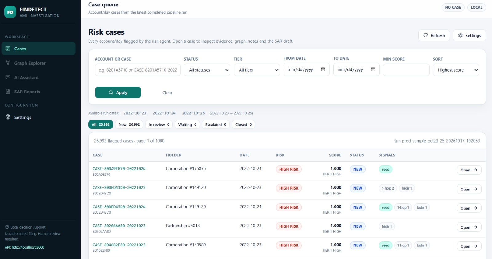
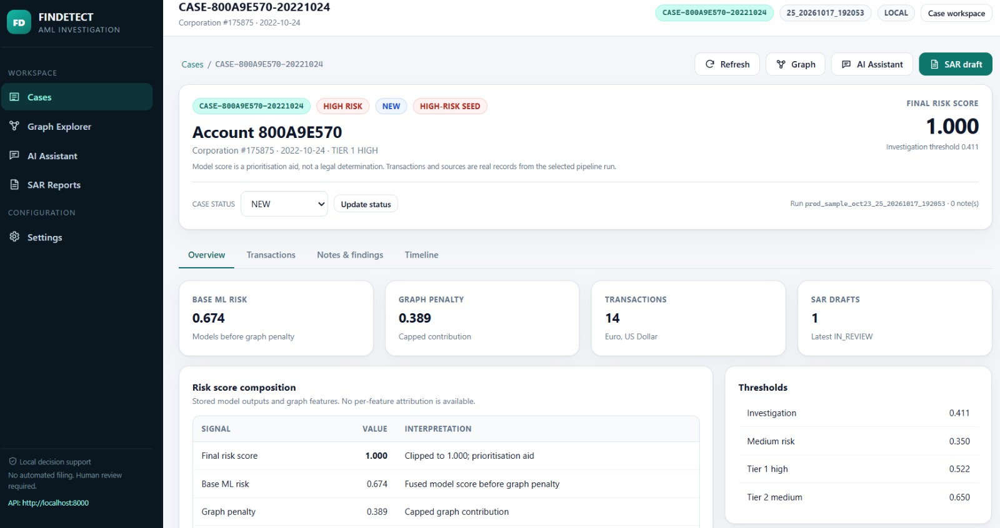
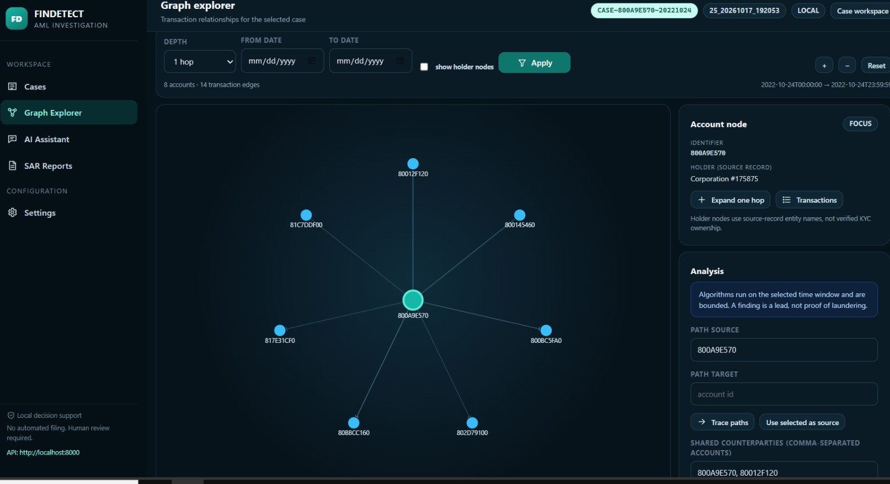
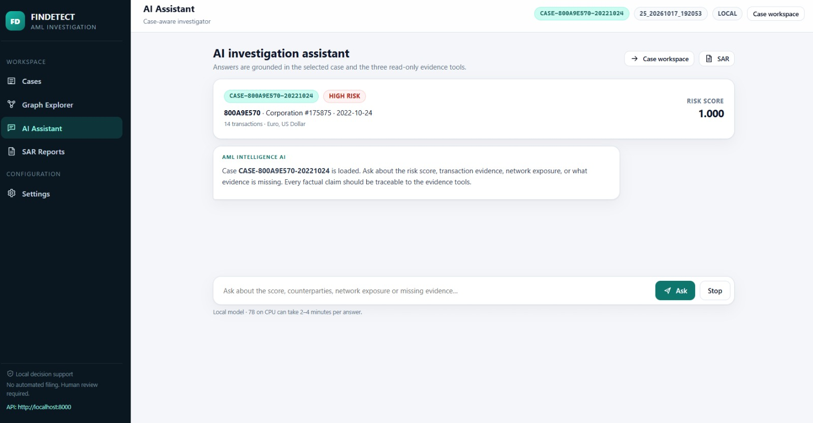
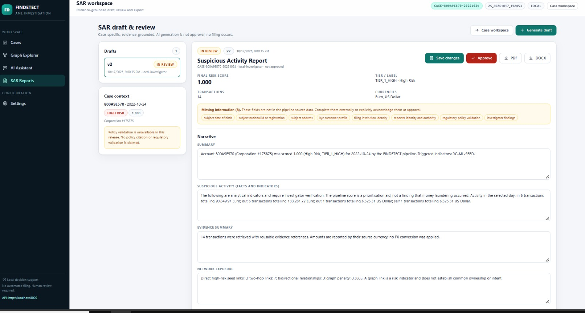
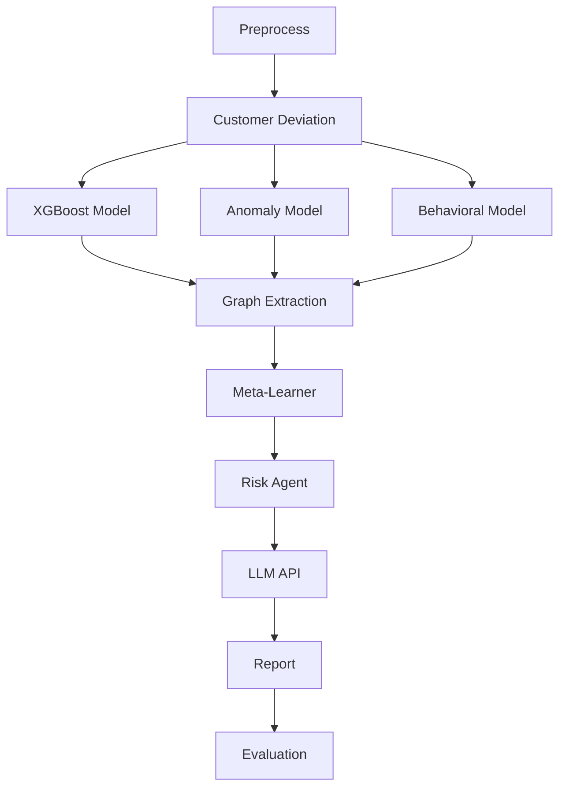
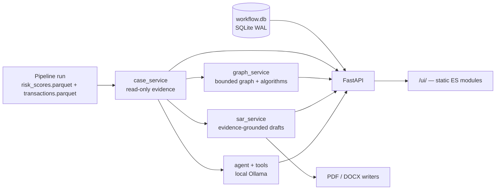

# FINDETECT

**AI-powered Anti-Money Laundering (AML) system** in two layers:

1. **Detection pipeline** — multiple ML models, customer-deviation analysis, transaction-graph context and a meta-learner fuse into one risk score per **account per day**, orchestrated with LangGraph.
2. **Investigator workspace** — a case-centred web application on top of the pipeline's saved output: real case queue → evidence → graph analysis → AI investigation → notes and audit trail → human-reviewed SAR with PDF/DOCX export.

Everything runs locally: Parquet/DuckDB for evidence, SQLite for workflow state, and a local Ollama model for the language layer. No transaction data leaves the machine, and nothing is ever filed to a regulator by this application.

---

## Table of Contents

1. [Overview](#overview)
2. [Key Features](#key-features)
3. [Screenshots](#screenshots)
4. [Quick Start](#quick-start)
5. [How It Works](#how-it-works)
6. [Project Structure](#project-structure)
7. [Requirements](#requirements)
8. [Installation](#installation)
9. [Usage — Detection Pipeline](#usage--detection-pipeline)
10. [Usage — Investigator Workspace](#usage--investigator-workspace)
11. [API Reference](#api-reference)
12. [Agentic Investigator](#agentic-investigator)
13. [Output Files](#output-files)
14. [Evaluation Results](#evaluation-results)
15. [Testing and Verification](#testing-and-verification)
16. [Configuration](#configuration)
17. [Troubleshooting](#troubleshooting)
18. [Data & Privacy](#data--privacy)
19. [Limitations & Disclaimer](#limitations--disclaimer)
20. [Roadmap](#roadmap)
21. [Contributing](#contributing)
22. [License](#license)
23. [Contact](#contact)

---

## Overview

Financial institutions and regulators must identify suspicious activity across very large volumes of transactions. Rules-based systems generate many false positives, and single-model approaches miss patterns that only appear when several signals are combined. Scoring alone is also not enough: an analyst still has to work the alert, collect evidence and write a defensible report.

FINDETECT covers both halves.

**Detection.** Every transaction batch runs through a multi-stage pipeline:

- Several independent detection models look at the data from different angles (supervised, unsupervised, behavioural).
- A **meta-learner** fuses their outputs into one risk score per account per day. It is a ranking score, not a calibrated probability (see [Limitations](#limitations--disclaimer)).
- A **risk agent** applies thresholds and signal filters, then tiers the queue.
- An **evaluation** step measures precision, recall and F1 for each model and for the final queue.

**Investigation.** The workspace reads the saved run and turns each flagged account/day into a case with its own evidence, graph, notes, timeline and SAR drafts. Scores and transactions stay read-only in Parquet; only investigator workflow state is written, into a local SQLite database with an append-only audit log.

**Intended audience:** compliance analysts, financial institutions, government and regulatory bodies, and developers/students building on the project.

---

## Key Features

### Detection pipeline

- **Multi-model detection** — XGBoost (supervised), autoencoder anomaly detection (unsupervised) and behavioural modelling run in parallel.
- **Customer deviation analysis** — compares each transaction against the customer's own historical behaviour.
- **Graph context extraction** — up to 3-hop exposure to high-risk seeds, bidirectional flows (layering) and fan-in/fan-out patterns (mule behaviour), with hub shielding for merchants.
- **Meta-learner fusion** — a trained stacking model learns how to weight the individual signals; includes fusion-weight optimisation and a weighted-average fallback.
- **Threshold tooling** — `pick_tiers.py` derives investigation, watchlist and tier cutoffs from a tuning window at chosen recall/precision targets; `pick_threshold..py` gives a quick coverage check instead of hard-coded cutoffs.
- **Batch processing** — run one file, one day, or all days.
- **Local analytical storage** — DuckDB + Parquet, no database server to operate.

### Investigator workspace

- **Real case queue** — every flagged account/day from the latest saved run, with search, status/tier/date/score filters, sorting and pagination. No synthetic or placeholder cases.
- **Case workspace** — score composition against the tier thresholds, network signals, per-currency activity, transaction explorer, notes/findings, audit timeline and status control in one case context.
- **Interactive graph investigation** — bounded account/transaction graph with node expansion, time-ordered money paths, time-ordered cycles, shared counterparties and connected components. Every finding carries transaction references.
- **Agentic AI investigator** — case-aware chat backed by three read-only evidence tools (`get_account_scores`, `get_transactions`, `get_graph_exposure`), with a visible tool trace, elapsed time, stop control and a deterministic offline memo when Ollama is unavailable. See [AGENTIC_AI.md](AGENTIC_AI.md).
- **Notes and audit trail** — explicit-save notes with author/version history, and append-only audit events for views, graph exploration, AI queries, status changes, SAR edits and exports.
- **SAR workflow** — evidence-grounded draft, versioned narrative editing, missing-field validation, review → human approval, and valid PDF/DOCX export. **No external filing.**
- **Ground-truth hygiene** — `Is Laundering` and `Pattern Type` are never returned by the API, never sent to the model and never shown in the UI.
- **Local-first security** — optional shared bearer token, explicit CORS allowlist, investigator attribution header and a data-root sandbox for pipeline inputs.
- **No build step** — the UI is plain ES modules and one local stylesheet, served by FastAPI itself at `/ui/`.

---

## Screenshots

The investigator workspace, shown on a real run of the sample dataset (account/day cases from `prod_sample_oct23_25`).

### Case queue



*Every flagged account/day from the latest pipeline run, with search, status, tier, date and score filters. Each row shows the case ID, holder, risk label, score, status and network signals (seed, 1-hop exposure, bidirectional flows).*

### Case workspace



*One case in detail: final risk score against the investigation threshold, base ML risk, graph penalty, transaction count by currency, SAR drafts, and the score composition with the tier thresholds. Tabs lead to transactions, notes and the timeline.*

### Graph explorer



*Bounded transaction graph around the selected account. Nodes can be expanded, and the side panel traces time-ordered money paths, cycles, shared counterparties and connected components. Findings are leads, not proof of laundering.*

### AI investigation assistant



*Case-aware chat running on a local model. Answers are grounded in the three read-only evidence tools, and each answer shows which tools it used. If the model is unavailable, an offline evidence memo is shown instead.*

### SAR draft and review



*Evidence-grounded draft with an editable narrative, a list of missing information, activity by currency and transaction evidence. A draft moves from draft to review to approval by a human, with PDF and DOCX export. Nothing is filed externally.*

---

## Quick Start

The workspace shows **real cases only**, so at least one pipeline run must exist before the queue has anything in it.

```powershell
# 1. Environment
python -m venv venv
venv\Scripts\activate            # macOS/Linux: source venv/bin/activate
pip install -r requirements.txt

# 2. Produce a run (needs the dataset + autoencoder package, see Installation)
python run_full_pipeline.py --input "Data/processed/prod_sample_oct23_25.parquet" --date 2022-10-24

# 3. Recommended settings for a CPU-only machine (optional)
$env:FINDETECT_AGENT_NATIVE_TOOLS = "0"
$env:FINDETECT_OLLAMA_TOOL_MODEL  = "qwen2.5"

# 4. One server for API + UI
uvicorn main:app --reload
```

Open **http://127.0.0.1:8000/ui/** — `http://127.0.0.1:8000/` redirects there, and the interactive API docs are at `/docs`.

Ollama is optional: without it the assistant returns a deterministic offline evidence memo, and every other page works normally.

---

## How It Works

### Detection pipeline

The pipeline is defined in `LangGraph.py` as a directed graph with a parallel fan-out and fan-in.



| Stage | Purpose |
|---|---|
| **Preprocess** | Loads the prepared feature dataset (Parquet) for the selected day. |
| **Customer Deviation** | Measures how far each transaction deviates from the customer's own historical behaviour. |
| **XGBoost model** | Supervised model that outputs a fraud probability per transaction. |
| **Autoencoder anomaly model** | Unsupervised neural network that scores how unusual a transaction is by its reconstruction error. |
| **Behavioural risk model** | Rule-based scoring of amount drift, frequency drift, peer-group outliers (robust MAD scaling) and short-term velocity. |
| **Graph Extraction** | Builds a daily transaction graph and adds context: exposure to high-risk accounts up to **3 hops**, **bidirectional flows** (layering indicator) and **fan-in / fan-out** patterns (money-mule indicator). Very high-degree accounts such as merchants are shielded from false seeding. |
| **Meta-Learner** | A trained stacking model that fuses the three model scores, graph features and customer-deviation features into one risk score per account per day. If the trained meta-learner is not found, the pipeline falls back to the weighted-average risk score. |
| **Risk Agent** | Applies the investigation threshold and signal filters, then sorts flagged accounts into `TIER_1_HIGH`, `TIER_2_MEDIUM` and `TIER_3_LOW` queues. |
| **LLM API** | Builds a structured case for the highest-risk accounts (top 25 per run) and writes deterministic legacy SAR template drafts. The investigator workspace creates new evidence-grounded, versioned drafts for any selected case. The limit of 25 reports is for local hardware; it can be raised on stronger hardware (`MAX_REPORTS` in `nodes.py`). |
| **Report** | Assembles the final results. |
| **Evaluation** | If ground-truth labels (`Is Laundering`) are present, computes precision, recall and F1 for each model and the Risk Agent. |

The three detection models run **in parallel**. Shared data moves between stages through a custom state object (`AMLPipelineState`), which uses a `merge_dicts` reducer so parallel branches can write their results without overwriting each other.

### Investigator workspace



| Layer | Storage | Mutability |
|---|---|---|
| Risk scores, transactions, graph evidence | Parquet files from the pipeline run | **Read-only.** The API never edits source records. |
| Case status, notes/versions, SAR drafts/versions/approval, audit events | `outputs/workflow/workflow.db` (SQLite, WAL) | Written only on explicit confirmation; audit is append-only. |
| AI answers | Not persisted as evidence | Returned with a tool trace; logged as an `AI_QUERY` audit event. |
| Exports | Generated on demand | Dependency-free writers produce valid PDF 1.4 and DOCX (OOXML) in-tree. |

Because evidence and workflow state are separate, re-running the pipeline never destroys investigator work, and deleting `workflow.db` never alters the underlying data.

---

## Project Structure

```
FINDETECT/
├── frontend/                        # Investigator workspace (no build step)
│   ├── index.html                   # Case queue
│   ├── case.html                    # Case overview / transactions / notes / timeline
│   ├── graph.html                   # Graph explorer
│   ├── assistant.html               # Case-aware AI investigator
│   ├── sar.html                     # SAR drafts, review, approval, export
│   ├── settings.html                # API connection, run/model status, pipeline trigger
│   ├── chat.html                    # Legacy link → safe redirect into the workspace
│   └── assets/                      # app.css + ES modules (api, ui, cases, case, graph, sar, settings)
├── models/                          # Trained models (autoencoder_final64/ is not committed)
├── Data/processed/                  # Input Parquet files (not committed)
├── docs/screenshots/                # UI screenshots used in this README
├── outputs/                         # Pipeline runs + workflow DB (generated, git-ignored)
├── tests/                           # Backend, real-data, graph, SAR, security and UI-contract tests
│   └── js/ui.test.mjs               # Frontend unit tests (node:test)
│
├── main.py                          # FastAPI app: routers, /ui/ mount, MIME fix, legacy routes
├── api_cases.py                     # Runs, cases, transactions, status, timeline, chat, meta
├── api_graph.py                     # Bounded graph + path/cycle/shared/component/expand routes
├── api_notes.py                     # Notes and findings routes
├── api_sar.py                       # SAR draft, review, approval and export routes
├── schemas.py                       # Typed request/response models and validation bounds
├── security.py                      # Token gate, investigator identity, data-root sandbox, safe filenames
├── case_service.py                  # Read-only case/transaction/Parquet access and run discovery
├── graph_service.py                 # Bounded graph loading and case graph responses
├── graph_algorithms.py              # Time-ordered paths/cycles, shared counterparties, components
├── workflow_store.py                # SQLite case state, notes, SAR versions, append-only audit
├── sar_service.py                   # Evidence-grounded draft, validation, approval, export
├── docx_writer.py / pdf_writer.py   # Dependency-free DOCX/PDF export
├── serve_frontend.py                # Optional standalone UI server with correct JS MIME types
│
├── agent.py                         # Tool-calling AML investigator (Ollama + offline fallback)
├── agent_cli.py                     # CLI for the evidence tools and the investigator
├── tools.py                         # Read-only evidence tools used by the LLM
├── config.py                        # Central configuration (every value env-overridable)
├── LangGraph.py                     # Pipeline graph definition and compilation
├── AMLPipelineState.py              # Shared pipeline state (merge_dicts reducer)
├── nodes.py                         # Node implementations for each pipeline stage
├── customer_deviation.py            # Customer behaviour deviation logic
├── meta_learner.py                  # Meta-learner model
├── LLM.py                           # Deterministic legacy SAR template
├── run_full_pipeline.py             # CLI runner (--input file and/or --date YYYY-MM-DD)
├── run_all_days.py                  # Runs the pipeline across multiple days
├── train_meta_learner_fixed.py      # Trains the meta-learner
├── optimize_fusion_weights.py       # Optimises the fusion weights
├── tune_weights.py                  # Weight sweep helper
├── pick_threshold..py               # Quick coverage check: share of account/days above fixed base_risk cutoffs
├── pick_tiers.py                    # Derives investigation, watchlist and tier cutoffs from eval_days.parquet
├── make_sample.py                   # Generates sample data
├── requirements.txt                 # Python dependencies
├── AGENTIC_AI.md                    # Agent design, tools, guardrails and fallbacks
├── LICENSE.circ                     # MIT license text
└── README.md
```

---

## Requirements

- **Python 3.10+** (the pinned versions in `requirements.txt` were validated on Python 3.13).
- The packages in `requirements.txt`: LangGraph, XGBoost, TensorFlow/Keras, scikit-learn, DuckDB, pyarrow, pandas, FastAPI, Uvicorn, Pydantic and the `ollama` client.
- **[Ollama](https://ollama.com)** with a pulled model — *optional*. Without it the assistant falls back to a deterministic evidence memo; cases, graph, notes and SAR are unaffected.
- **Node.js 18+** — optional, only to run the frontend unit tests (`node:test`).
- No extra dependency is needed for exports: `pdf_writer.py` and `docx_writer.py` are self-contained (no ReportLab / python-docx).

---

## Installation

```bash
# 1. Clone the repository
git clone https://github.com/aml-compliance-system/aml-compliance-system.git
cd aml-compliance-system

# 2. Create and activate a virtual environment
python -m venv venv
source venv/bin/activate        # Windows: venv\Scripts\activate

# 3. Install dependencies
pip install -r requirements.txt

# 4. Optional: local LLM for explanations and the AI assistant
ollama pull qwen2.5
```

### Dataset and model files

The dataset and the autoencoder package are **not** in the repository.

- Dataset (Google Drive): <https://drive.google.com/drive/u/0/folders/15Jb5T64Ua99DMZWRbz8ptRSEMY2KBLKQ>

  ```bash
  pip install gdown
  gdown --folder 15Jb5T64Ua99DMZWRbz8ptRSEMY2KBLKQ
  ```

- Place the feature Parquet files under `Data/processed/` (or point `FINDETECT_FINAL_DATA_DIR` at them).
- Place the autoencoder package in `models/autoencoder_final64/`:
  - `autoencoder_final64_fixed.keras`
  - `preprocessing_and_scoring_final64.joblib`
  - `metadata_final64.json`

The pipeline stops with a clear error message if the data or the autoencoder package is missing. The XGBoost model and the trained meta-learner **are** committed under `models/`.

---

## Usage — Detection Pipeline

### 1. Run one file, one day, or both

```bash
# Whole file (no date needed)
python run_full_pipeline.py --input "Data/processed/prod_sample_oct23_25.parquet"

# One day of the full 64-file dataset
python run_full_pipeline.py --date 2022-09-01

# One day of a single file
python run_full_pipeline.py --input "Data/processed/prod_sample_oct23_25.parquet" --date 2022-10-24
```

`--date` must be a real `YYYY-MM-DD` date that exists in your data. The script prepares the input with DuckDB, runs the full LangGraph pipeline and saves the results under `outputs/FINDETECT_Pipeline_Output/<run>/`.

### 2. Run across multiple days

```bash
python run_all_days.py
```

### 3. Optional utilities

```bash
python make_sample.py               # generate sample data
python optimize_fusion_weights.py   # optimise fusion weights
```

### 4. Train the meta-learner

The meta-learner is trained on **account/day** rows built with the same aggregation used at inference (maximum of each model score per account per day, plus graph and customer-deviation features).

```bash
python train_meta_learner_fixed.py \
    --train-window <START>:<END> \
    --input-glob "Data/processed/block_d_numerical_bucket_*.parquet" \
    --neg-sample-rate 0.5
```

| Argument | Meaning |
|---|---|
| `--train-window` | Date window to train on (`YYYY-MM-DD:YYYY-MM-DD`, end date included). It must **not overlap** the window you evaluate on. |
| `--neg-sample-rate` | Fraction of non-suspicious transactions kept, to fit in memory. All suspicious transactions are always kept. The reported results use `0.5`. `1.0` disables sampling. |

Things to know:

- The trained model is saved to `models/meta_learner_calibrated.pkl`, with its sampling rate in a `.json` file next to it. **Back up the file before retraining** — a new run overwrites it.
- Graph features (`hop1_count`, `bidir_count`, …) are computed on the sampled transactions, so a lower sampling rate gives a thinner graph in training than at inference.
- Graph features depend on the seed threshold and the fusion weights in `config.py`. **Retrain the meta-learner whenever you change either.**
- The scores are not probabilities. Sampling and calibration shift their scale, so choose thresholds from data, not from a fixed number such as 0.5.

### 5. Choose the alert thresholds

1. Run the pipeline on a **tuning window**. When ground truth is present, the evaluation step writes `eval_days.parquet` to the project root (one row per account/day with its score and the true label).
2. Derive the cutoffs from that file:

   ```bash
   python pick_tiers.py --recall 0.75 --medium-recall 0.85 \
       --tier1-precision 0.40 --tier2-precision 0.30
   ```

   `--recall` sets the investigation threshold, `--medium-recall` the watchlist threshold, and the two precision targets set the tier cutoffs. `--file` points at a different `eval_days.parquet`; `--min-flagged` ignores tiny top slices.
3. For a quick sanity check of queue volume, `python pick_threshold..py` prints the share of account/days above a few fixed `base_risk` cutoffs in the latest run. It is a coverage check, not a precision/recall analysis.
4. Put the chosen values in `config.py` (or set the equivalent environment variables).
5. Run the pipeline on a **different window** without changing anything, and report those numbers.

Choosing thresholds and reporting results on the same window makes results look better than they will be on new data.

> **Note:** the coverage helper is committed as `pick_threshold..py` (double dot). Use the file name as it exists, or rename it locally.

### 6. Use the pipeline programmatically

```python
from LangGraph import app

final_state = app.invoke({"final_parquet_path": "path/to/daily_file.parquet"})
risk_scores = final_state["risk_scores"]   # pandas DataFrame, one row per account/day
```

---

## Usage — Investigator Workspace

### Start the server

**Recommended — one server for API and UI:**

```powershell
uvicorn main:app --reload
```

Open **http://127.0.0.1:8000/ui/**. FastAPI mounts `frontend/` at `/ui/` and registers the correct JavaScript/CSS MIME types before mounting, so ES modules execute and no CORS setup is needed. `http://127.0.0.1:8000/` redirects to `/ui/`.

**Optional — separate frontend server:**

```powershell
python serve_frontend.py --port 5600
```

Then open `http://127.0.0.1:5600/`; the UI targets the API on port 8000 (configurable in **Settings**). This is only useful if you want to edit frontend files independently.

> **Do not** use plain `python -m http.server` (on Windows the registry can serve `.js` as `text/plain`, which blocks ES modules and produces a blank shell), `file://`, or VS Code Live Server (it reloads whenever pipeline outputs change). Every page shows an explicit "UI scripts did not load" message with the correct command if modules fail to execute.

### Typical workflow

1. **Cases** — the real account/day queue from the latest run: search, status/tier/date/score filters, sorting, pagination.
2. **Open a case** — score composition, thresholds, network signals, per-currency activity; the case ID lives in the URL so a case can be shared or bookmarked.
3. **Transactions** — bounded, filterable, paginated evidence with `TX-…` provenance references and the source file.
4. **Graph explorer** — expand nodes, trace time-ordered money paths, detect time-ordered cycles, find shared counterparties and connected components. Every finding links back to transaction references.
5. **AI assistant** — case-aware chat using the three evidence tools; tool calls, offline mode and elapsed time are shown, and a running answer can be stopped.
6. **Notes & findings / timeline** — explicit-save notes with author and version history, plus the append-only audit trail.
7. **SAR reports** — generate an evidence-grounded draft, edit the narrative, review the missing-field panel, submit for review, approve as a human, export PDF or DOCX. **Nothing is filed externally.**
8. **Settings** — API base URL, optional bearer token (kept in `sessionStorage` only), run/model status, capability list and a pipeline trigger.

The API reads the **latest saved run** by default. Use the `run` query parameter in the UI, or `run_id` in the API, to open a historical run. If no run exists, the queue shows an actionable empty state instead of inventing a case.

### How cases and evidence are identified

- **Case ID** — one case is one account on one day: `CASE-{account}-{YYYYMMDD}` (for example `CASE-8201A5710-20221024`). The pipeline has no case ID of its own, so it is derived from `risk_scores.parquet`, where `(Account, graph_date)` is unique. The same account on two days gives two cases, which is why five same-account alerts no longer collapse into one.
- **Transaction reference** — the source data has no transaction ID, so each transaction gets a deterministic `TX-…` hash of its timestamp, sender, receiver, amount paid, currency and payment format. It is a provenance aid, **not** an industry identifier.
- **Currencies** — the data holds 15 currencies and no exchange rates. Totals are always per currency; a single combined total is shown only when a case has exactly one currency.
- **Account holders** — names come from the source record (`Entity_ID`, `Entity_Name`). They are not verified KYC data.
- **Ground-truth labels** — `Is Laundering` and `Pattern Type` exist in the raw transactions but are never returned by the API, never included in SAR content or AI context, and never rendered.

### Workflow rules enforced by the backend

| Rule | Behaviour |
|---|---|
| Explicit confirmation | Every write (status change, note create/update, SAR create/edit/review/approve) requires `"confirm": true`; otherwise HTTP 400. |
| Case status | `NEW`, `IN_REVIEW`, `WAITING_INFO`, `ESCALATED`, `CLOSED`. |
| Note types | `NOTE`, `FINDING`, `HYPOTHESIS`. Only `FINDING` notes are pulled into a SAR draft. |
| Versioning | Editing a note or a SAR draft increments its version; previous versions are kept. |
| SAR lifecycle | `DRAFT → IN_REVIEW → APPROVED` (plus `SUPERSEDED`). Approval is rejected unless the draft is in review. |
| Missing fields | Approval with outstanding missing fields requires `"acknowledge_missing": true`. |
| Re-edit after approval | Editing a draft resets it to `DRAFT` and clears the approval — approval never survives a content change. |
| AI is not approval | Model output is never treated as a decision, and there is no regulator-filing endpoint. |
| Audit | Views, graph exploration, AI queries, status changes, note/SAR writes and exports append events to the timeline. |

**SAR missing fields.** Seven external fields are always flagged because the source data cannot supply them: subject date of birth, national ID/registration, address, KYC customer profile, filing-institution identity, reporter identity/authority, and regulatory policy validation. Additional fields are flagged conditionally (holder name, transaction evidence, risk assessment, investigator findings). They are surfaced, never fabricated.

---

## API Reference

Interactive documentation: **`/docs`** (Swagger UI) and **`/openapi.json`**.

### Authentication and identity

| Header | When | Notes |
|---|---|---|
| `Authorization: Bearer <token>` | Only if `FINDETECT_API_TOKEN` is set on the server | Compared in constant time; missing/incorrect → HTTP 401. Empty token = local-only mode. |
| `X-Investigator-Id: <name>` | Optional | Attribution for notes, approvals and audit. 1–64 chars: letters, digits, space, `.`, `_`, `@`, `-`. Defaults to `FINDETECT_INVESTIGATOR_ID`. This is **not** authenticated identity. |

Common status codes: `400` invalid input or missing confirmation · `401` token required · `403` input outside the data root · `404` unknown case/run/draft · `503` evidence for the run is unavailable.

### Runs, cases and evidence

| Endpoint | Purpose |
|---|---|
| `GET /api/runs` | Saved runs (id, paths, summary, created_at, legacy-report flag). |
| `GET /api/cases` | Paginated case queue. Filters: `run_id`, `status`, `tier`, `risk_label`, `date_from`, `date_to`, `min_score`, `max_score`, `account`, `q`; `sort` = `score_desc` (default), `score_asc`, `date_desc`, `date_asc`, `account`; `page`, `page_size` (max 100). Returns totals, page count, status counts and available dates. |
| `GET /api/cases/{case_id}` | Case detail: score composition, model scores, thresholds, graph features, transaction summary, SAR status, legacy report, notes count. `track=false` skips the `CASE_VIEWED` audit event. |
| `GET /api/cases/{case_id}/transactions` | Paginated evidence with per-currency aggregates. Filters: `direction` (`both`/`in`/`out`), `counterparty`, `min_amount`, `max_amount`, `from`, `to`, `page`, `page_size`. |
| `PATCH /api/cases/{case_id}/status` | Status change. Body: `{"status": "IN_REVIEW", "assigned_to": "...", "confirm": true}`. |
| `GET /api/cases/{case_id}/timeline` | Audit events, `limit` 1–500 (default 100). |
| `POST /api/cases/{case_id}/chat` | Case-aware AI investigation. Body: `{"message": "...", "history": []}`. Returns answer, tool trace, steps, model, `degraded`, warnings and `elapsed_ms`. |
| `GET /api/meta` | Current run, auth mode, investigator, model, native-tool flag, limits, capabilities and policy-validation status. |
| `POST /pipeline/analyze` | Runs the pipeline. Body: `{"final_parquet_path": "...", "date": "YYYY-MM-DD"}`. The input must be a `.parquet` file inside `FINDETECT_DATA_ROOT`. |

### Graph

| Endpoint | Purpose |
|---|---|
| `GET /api/cases/{case_id}/graph` | Bounded case graph. Query: `depth` (1–2), `limit_nodes` (≤100), `limit_edges` (≤300), `include_holders`, `from`, `to`. Returns nodes, edges, window, `truncated` + reason and the applied limits. |
| `POST /api/cases/{case_id}/graph/expand` | Expand one node. Body: `{"account": "...", "direction": "both"\|"in"\|"out"}`. |
| `POST /api/cases/{case_id}/graph/paths` | Time-ordered money-flow paths. Body: `{"source": "...", "target": "...", "max_depth": 4}` (≤4). |
| `POST /api/cases/{case_id}/graph/cycles` | Time-ordered directed cycles. Body: `{"max_length": 4}` (2–5). |
| `POST /api/cases/{case_id}/graph/shared-counterparties` | Body: `{"accounts": ["A","B"], "min_shared": 2}` (2–10 accounts). |
| `POST /api/cases/{case_id}/graph/components` | Connected components. Body: `{"account": "..."}` (optional; defaults to the focal account). |

The default window is the case day; `from`/`to` may widen it up to `FINDETECT_GRAPH_MAX_WINDOW_DAYS` (7). Edges are real transactions carrying `transaction_ref`, amount, currency, timestamp and source file. Analyses are bounded by the configured path/cycle/visited limits and report `truncated` when a bound is hit.

### Notes and audit

| Endpoint | Purpose |
|---|---|
| `GET /api/cases/{case_id}/notes` | Notes and findings for the case. |
| `POST /api/cases/{case_id}/notes` | Create. Body: `{"body": "...", "note_type": "FINDING", "confirm": true}` (≤20,000 chars). |
| `PATCH /api/notes/{note_id}` | Edit, creating a new version. Body: `{"body": "...", "confirm": true}`. |

### SAR

| Endpoint | Purpose |
|---|---|
| `GET /api/cases/{case_id}/sar` | List drafts for the case. |
| `POST /api/cases/{case_id}/sar/drafts` | Generate an evidence-grounded draft. Body: `{"confirm": true, "include_legacy_report": true}`. |
| `GET /api/sar/drafts/{draft_id}` | One draft with content, evidence, missing fields, validation and approval metadata. |
| `PATCH /api/sar/drafts/{draft_id}` | Edit content, creating a new version. Body: `{"content": {...}, "confirm": true}`. |
| `POST /api/sar/drafts/{draft_id}/submit-review` | Move to review. Body: `{"confirm": true}`. |
| `POST /api/sar/drafts/{draft_id}/approve` | Human approval. Body: `{"confirm": true, "acknowledge_missing": true}`. |
| `POST /api/sar/drafts/{draft_id}/export?format=pdf\|docx` | Download the draft as a valid PDF 1.4 or DOCX file (audited as `SAR_EXPORTED`). |

Draft content follows the `findetect.sar.v1` schema: case, risk breakdown, reason codes, per-currency activity, transaction evidence and refs, investigator findings, narrative, the legacy pipeline report as historical context, missing fields, policy-validation status and a disclaimer.

### Legacy endpoints (kept for compatibility)

`POST /chat`, `GET /agent/tools`, `POST /agent/tool`, `POST /agent/review` and `GET /case/{account_or_case_id}` still work; `/case/{id}` also accepts the new account/day case IDs. New work should use the `/api/...` routes.

### Example

```bash
# Queue, first page
curl "http://127.0.0.1:8000/api/cases?page=1&page_size=5"

# One case and its evidence
curl "http://127.0.0.1:8000/api/cases/CASE-8201A5710-20221024"
curl "http://127.0.0.1:8000/api/cases/CASE-8201A5710-20221024/transactions?direction=out"

# Draft → review → approve → export
curl -X POST "http://127.0.0.1:8000/api/cases/CASE-8201A5710-20221024/sar/drafts" \
     -H "Content-Type: application/json" -d '{"confirm": true}'
curl -X POST "http://127.0.0.1:8000/api/sar/drafts/1/submit-review" \
     -H "Content-Type: application/json" -d '{"confirm": true}'
curl -X POST "http://127.0.0.1:8000/api/sar/drafts/1/approve" \
     -H "Content-Type: application/json" -d '{"confirm": true, "acknowledge_missing": true}'
curl -X POST "http://127.0.0.1:8000/api/sar/drafts/1/export?format=pdf" -o sar.pdf
```

Add `-H "Authorization: Bearer <token>"` to every call when `FINDETECT_API_TOKEN` is set.

---

## Agentic Investigator

The assistant is case-aware: it receives the selected account/day and uses three **read-only** tools before answering.

| Tool | What it returns |
|---|---|
| `get_account_scores(account_id, date)` | Final score, tier, model components, graph penalty, graph features, thresholds, score history. |
| `get_transactions(account_id, date, direction, limit, min_amount)` | Directional flow totals by source currency, top counterparties and recent transactions. |
| `get_graph_exposure(account_id, date)` | One-hop seed exposure with direction, two/three-hop counts, layering/mule indicators and penalty breakdown. |

Every answer carries an evidence trace. With `FINDETECT_AGENT_NATIVE_TOOLS=0` the agent uses the JSON protocol and a prefetched evidence brief — the recommended setting for a 7B model on CPU. If Ollama is down or times out, the assistant returns a deterministic **offline evidence memo** instead of an error. A 3B model is faster but less reliable at reading directional amounts; 7B is recommended when accuracy matters, and answers can take 2–4 minutes on CPU.

```powershell
python agent_cli.py chat --case 100428660 --date 2022-10-23 `
  --message "Why was this account flagged, and what is still unknown?"

# No LLM: deterministic evidence memo
python agent_cli.py chat --case 100428660 --date 2022-10-23 `
  --message "Summarise" --no-llm
```

Tool schemas, guardrails, fallbacks and performance notes: [AGENTIC_AI.md](AGENTIC_AI.md).

---

## Output Files

Results are written to `outputs/FINDETECT_Pipeline_Output/<run>/`, where `<run>` is the date, or the input file name when no date is given (web runs add a timestamp).

| File | Content |
|---|---|
| `risk_scores.parquet` | Risk score, risk label, investigation flag and tier for every account on that day. **This file is what makes a run visible to the workspace.** |
| `sar_reports.jsonl` | Legacy pipeline template drafts for the top 25 alerts. The workspace creates its own versioned, evidence-grounded drafts in SQLite. |
| `summary.json` | Run summary (`account_day_rows`, `investigation_cases`, `high_risk_seeds`, …) including `input_parquet` — the transactions file the workspace reads for evidence, graph and SAR. |

Two files are written outside the run folder:

- `eval_days.parquet` — one row per account/day with score and true label, written to the **project root** when ground truth is available; read by `pick_tiers.py`.
- `outputs/workflow/workflow.db` — investigator workflow state (case status, notes, SAR versions, audit).

> If a run folder is moved or `summary.json` loses its `input_parquet` reference, the case queue still loads but transactions, graph and SAR evidence become unavailable (HTTP 503). The API falls back to `FINDETECT_DEFAULT_PARQUET` when it is set and the file exists.

---

## Evaluation Results

FINDETECT is evaluated at two levels: each detection model is scored per **transaction**, and the final Risk Agent is scored per **account/day**, which is the level at which a compliance analyst actually reviews alerts. Because the grains differ, the two tables should not be compared row by row.

Suspicious activity is extremely rare in this data (about 0.18% of transactions and 0.53% of account/days), so accuracy is not a useful metric. Precision, recall and F1 on the suspicious class are reported instead.

**Evaluation data:** `Data/processed/prod_sample_oct23_25.parquet`, 2,761,250 transactions from 23 to 25 October 2022 (4,833 suspicious transactions). At account/day level that is 789,075 account/days, of which 4,184 are suspicious. The meta-learner was trained on an earlier window that does not overlap this one.

### Individual models (transaction level)

Decision thresholds used for evaluation: XGBoost probability ≥ 0.50, autoencoder anomaly score ≥ 0.98, behavioural score ≥ 0.40. They were chosen from threshold sweeps (printed by the evaluation step) on this same data, so these three rows are somewhat optimistic.

| Model | Precision | Recall | F1-Score | TP | FP | FN | TN |
|---|---|---|---|---|---|---|---|
| XGBoost | 0.1234 | 0.0368 | 0.0567 | 178 | 1,264 | 4,655 | 2,755,153 |
| Autoencoder (anomaly) | 0.0093 | 0.1202 | 0.0173 | 581 | 61,674 | 4,252 | 2,694,743 |
| Behavioral Risk | 0.0509 | 0.1386 | 0.0744 | 670 | 12,503 | 4,163 | 2,743,914 |

The models behave very differently. XGBoost is the most precise at high scores (about 77% precision at a score of 0.75, with very few cases caught), the behavioural model is moderately precise and catches more, and the autoencoder is only slightly better than random (about 5× the base rate at its strictest cutoff). No single model is sufficient on its own, which is the reason for the fusion step.

### Final Risk Agent (account/day level)

| Metric | Value |
|---|---|
| Precision | 0.1165 (11.7%) |
| Recall | 0.7517 (75.2%) |
| F1-Score | 0.2017 |
| True Positives | 3,145 |
| False Positives | 23,849 |
| False Negatives | 1,039 |
| True Negatives | 761,042 |

Of 789,075 account/days, the Risk Agent flagged 26,994 (about 3.4%) and caught 3,145 of the 4,184 truly suspicious ones. That is roughly 22 times more precise than reviewing account/days at random (base rate 0.53%), while recovering about three quarters of the suspicious activity.

### Choosing an operating point

The numbers above are a **high-recall** setting (about 75% recall). Raising the investigation threshold sends fewer accounts to review and makes each alert more likely to be real, but misses more suspicious accounts. Lowering it does the reverse. Across the configurations tested, precision at a fixed recall level was similar, so the threshold is mainly a choice about review capacity: how many alerts per day your analysts can work through. Use `pick_tiers.py` to see the trade-off on your data, and `pick_threshold..py` for the resulting queue volume.

### Reading these results

- The combined Risk Agent reaches far higher recall (75.2%) than any individual model (at most 14% at the thresholds above), which shows the benefit of fusing models and graph context.
- Precision is still low in absolute terms (11.7%), so most alerts are false positives and need human review.
- The ceiling is set by the base models. If none of them scores a suspicious account highly, the fusion step cannot recover it. Better input features would help more than further threshold changes.
- These figures come from one dataset and one configuration, and the thresholds were tuned on the same window. Re-evaluate on a separate window and on your own data before operational use.

---

## Testing and Verification

```powershell
# Backend: API, cases, graph, SAR, workflow, security, agent and real-data tests
python -m pytest tests -q

# Frontend unit tests (Node 18+)
node tests/js/ui.test.mjs
```

| Suite | Coverage |
|---|---|
| `test_api.py` | Route contracts, confirmation gates, auth mode, error mapping. |
| `test_case_service.py` | Case IDs, run discovery, filters, pagination, per-currency aggregates, provenance refs. |
| `test_graph_algorithms.py` / `test_graph_service.py` | Time-ordered paths and cycles, shared counterparties, components, bounding and truncation. |
| `test_workflow.py` | SQLite state, note/SAR versioning, approval rules, append-only audit. |
| `test_sar_service.py` | Draft grounding, missing fields, validation, approval, PDF/DOCX byte-level validity. |
| `test_tools.py` / `test_agent.py` | Evidence tools, agent loop, guardrails and offline fallback (no Ollama needed). |
| `test_frontend_contract.py` | Page shells, asset wiring, absence of placeholder cases, no ground-truth leakage. |
| `test_real_data.py` | Integration against the newest saved run; **skipped automatically when no run exists**. |
| `tests/js/ui.test.mjs` | HTML escaping, markdown rendering, formatters, badges, query builder. |

**Reference verification run** (real dataset, Windows, CPU-only):

| Check | Result |
|---|---|
| Backend suite | 98 passed, 1 third-party warning |
| Frontend unit tests | 5 passed |
| Real case queue | 26,992 cases, 1,080 pages at 25 per page |
| Reference case | `CASE-8201A5710-20221024`: score 1.000, 13 transactions, Yuan; inbound 54,417.07 (3), outbound 78,728.31 (10) |
| Real graph | 6 nodes, 13 transaction edges, holder metadata from source records |
| SAR | Draft with 13 evidence rows and 8 flagged missing fields; valid PDF (`%PDF-1.4`, valid xref) and DOCX (`word/document.xml`) |
| Browser smoke | Cases, case workspace, transactions tab, graph, assistant, SAR and settings rendered in headless Chrome against the live API |

Browser coverage is headless-Chrome smoke testing plus static page contracts and JS unit tests — **not** an automated browser-interaction suite, because the browser-automation dependency could not be installed in the build environment.

---

## Configuration

Everything in `config.py` can be overridden with an environment variable; no code edit is required.

### Paths

| Variable | Purpose | Default |
|---|---|---|
| `FINDETECT_FINAL_DATA_DIR` | Folder with the 64 `block_d_numerical_bucket_*.parquet` feature files | `Data/processed/FINDETECT_Block_D_Numerical_Final` |
| `FINDETECT_DEFAULT_PARQUET` | Default single-file input, and fallback transactions file for a run | `Data/processed/prod_sample_oct23_25.parquet` |
| `FINDETECT_DATA_ROOT` | Sandbox: pipeline inputs must resolve inside this directory | `Data/processed` |
| `FINDETECT_OUTPUT_DIR` | Where run results are saved | `outputs/FINDETECT_Pipeline_Output` |
| `FINDETECT_WORKFLOW_DB` | SQLite workflow database (case state, notes, SAR, audit) | `outputs/workflow/workflow.db` |
| `FINDETECT_TEMP_DIR` | Temporary daily Parquet files | `.tmp/findetect_daily` |
| `AUTOENCODER_MODEL_DIR` | Folder with the autoencoder package | `models/autoencoder_final64` |
| `FINDETECT_XGBOOST_MODEL` | XGBoost model file | `models/final_xgboost_aml_model.json` |
| `FINDETECT_LOG_LEVEL` | Logging level | `INFO` |

### Fusion weights and thresholds

| Variable | Purpose | Default |
|---|---|---|
| `FINDETECT_XGB_WEIGHT`, `FINDETECT_ANOMALY_WEIGHT`, `FINDETECT_BEHAVIORAL_WEIGHT` | Weights combining the three model scores into `base_risk` (must sum to 1.0) | `0.15`, `0.50`, `0.35` |
| `FINDETECT_SEED_THRESHOLD` | `base_risk` above which an account becomes a high-risk seed for graph exposure | `0.60` |
| `FINDETECT_INVESTIGATION_THRESHOLD` | Meta-learner score at or above which an account is sent for investigation | `0.411` |
| `FINDETECT_MEDIUM_RISK_THRESHOLD` | Score at or above which an unflagged account is labelled Medium Risk (watchlist) | `0.350` |
| `FINDETECT_TIER_1_THRESHOLD`, `FINDETECT_TIER_2_THRESHOLD` | Cutoffs for `TIER_1_HIGH` and `TIER_2_MEDIUM`; other flagged accounts are `TIER_3_LOW` | `0.522`, `0.650` |
| `FINDETECT_GRAPH_PENALTY`, `FINDETECT_INDIRECT_PENALTY`, `FINDETECT_BIDIR_PENALTY`, `FINDETECT_FAN_BOOST`, `FINDETECT_GRAPH_PENALTY_CAP` | Graph penalty shaping | `0.3046`, `0.0555`, `0.08`, `0.12`, `0.75` |

> **Tier ordering matters.** Tiers are assigned in order: score ≥ `TIER_1` → `TIER_1_HIGH`, else score ≥ `TIER_2` → `TIER_2_MEDIUM`, else `TIER_3_LOW`. The shipped defaults have `TIER_1 (0.522) < TIER_2 (0.650)`, so **`TIER_2_MEDIUM` is empty with the default configuration**. To use all three tiers, set `MEDIUM ≤ INVESTIGATION ≤ TIER_2 ≤ TIER_1` (for example `TIER_2=0.522`, `TIER_1=0.650`). Changing fusion weights or the seed threshold changes the graph features, so retrain the meta-learner afterwards.

### Ollama and the agent

| Variable | Purpose | Default |
|---|---|---|
| `FINDETECT_OLLAMA_HOST` | Ollama base URL | `http://localhost:11434` |
| `FINDETECT_OLLAMA_MODEL` | Model for the legacy single-shot chat | `qwen2.5` |
| `FINDETECT_OLLAMA_TOOL_MODEL` | Model for the tool-using agent | inherits the chat model |
| `FINDETECT_AGENT_ENABLED` | `0` restores the original single-shot chat | `1` |
| `FINDETECT_AGENT_NATIVE_TOOLS` | Ollama native tool calling; set `0` on slow CPU machines | `1` |
| `FINDETECT_AGENT_MAX_STEPS` | Tool-calling rounds before a forced answer | `5` |
| `FINDETECT_AGENT_NUM_CTX` | Agent context window (Ollama's 4096 default is too small) | `8192` |
| `FINDETECT_AGENT_OLLAMA_TIMEOUT` | Per-call timeout, seconds | `300` |
| `FINDETECT_AGENT_KEEP_ALIVE` | How long the model stays resident | `30m` |
| `FINDETECT_AGENT_WARMUP` | Load the model in the background at API startup | `1` |
| `FINDETECT_AGENT_MAX_HISTORY` | Conversation turns forwarded back to the model | `10` |
| `FINDETECT_AGENT_TX_LIMIT`, `FINDETECT_AGENT_TX_MAX_LIMIT` | Transaction rows per tool call | `25`, `100` |
| `FINDETECT_OLLAMA_TEMPERATURE`, `FINDETECT_OLLAMA_NUM_PREDICT`, `FINDETECT_OLLAMA_TIMEOUT` | Legacy chat decoding and timeout | `0.1`, `400`, `120` |

### API, security and bounds

| Variable | Purpose | Default |
|---|---|---|
| `FINDETECT_API_TOKEN` | Optional shared bearer token for every data endpoint; empty = local-only | empty |
| `FINDETECT_INVESTIGATOR_ID` | Default attribution when no `X-Investigator-Id` header is sent | `local-investigator` |
| `FINDETECT_CORS_ORIGINS` | Comma-separated allowed origins | `http://127.0.0.1:5600,http://localhost:5600,http://127.0.0.1:8000,http://localhost:8000` |
| `FINDETECT_CASE_PAGE_SIZE`, `FINDETECT_CASE_PAGE_SIZE_MAX` | Default and maximum page size | `25`, `100` |
| `FINDETECT_GRAPH_MAX_NODES`, `..._EDGES`, `..._DEPTH` | Graph bounding limits | `100`, `300`, `2` |
| `FINDETECT_GRAPH_MAX_PATHS`, `..._CYCLES`, `..._VISITED` | Analysis bounds | `20`, `20`, `1000` |
| `FINDETECT_GRAPH_MAX_PATH_DEPTH`, `FINDETECT_GRAPH_MAX_WINDOW_DAYS` | Path depth and time-window caps | `4`, `7` |
| `FINDETECT_SAR_MAX_EVIDENCE_ROWS` | Transaction evidence rows stored in a SAR draft | `50` |

Example (Windows PowerShell):

```powershell
$env:FINDETECT_FINAL_DATA_DIR = "D:\data\processed"
$env:FINDETECT_API_TOKEN      = "your-shared-token"   # then enter it in Settings
$env:FINDETECT_WORKFLOW_DB    = "outputs\workflow\workflow.db"
$env:FINDETECT_DATA_ROOT      = "Data\processed"
uvicorn main:app --reload
```

Because the LLM runs locally, no API key is required. Keep any future secrets in environment variables or a local `.env` file excluded through `.gitignore`.

---

## Troubleshooting

| Symptom | Cause and fix |
|---|---|
| **Blank page: empty sidebar/topbar** | The HTML loaded but its ES modules did not execute. Open `http://127.0.0.1:8000/ui/` (or run `python serve_frontend.py --port 5600`). Never use `python -m http.server`, `file://` or Live Server. Each page prints an explicit "UI scripts did not load" hint after two seconds. |
| **Case queue is empty after reload** | No saved run is visible. Run the pipeline once; the queue reads `risk_scores.parquet` from the newest folder under `FINDETECT_OUTPUT_DIR`, not from the in-memory pipeline response. Check `GET /api/runs`. |
| **`UNKNOWN-CASE` or "No report context loaded"** | An old bookmark/link without a real account/day ID. Open the case from the queue; `chat.html` redirects legacy links safely instead of inventing a case. |
| **Case loads but transactions/graph return 503** | The run's transactions Parquet is missing or moved. Restore the file referenced by `summary.json → input_parquet`, or set `FINDETECT_DEFAULT_PARQUET` to the correct file. |
| **HTTP 403 on `/pipeline/analyze`** | The input resolves outside `FINDETECT_DATA_ROOT`, or is not a `.parquet` file. Move the file inside the data root or widen the setting deliberately. |
| **HTTP 401 on every request** | `FINDETECT_API_TOKEN` is set on the server. Enter the same token in **Settings** (stored in `sessionStorage` only) or send `Authorization: Bearer <token>`. |
| **HTTP 400 "Explicit confirmation is required"** | A write was sent without `"confirm": true`. This is intentional for every state change. |
| **CORS error from the browser** | The UI origin is not in `FINDETECT_CORS_ORIGINS`. Serving the UI from `/ui/` avoids the issue entirely. |
| **Assistant says offline / degraded** | Ollama is not running, the model is not pulled, or the call timed out. The answer is then a deterministic evidence memo. Start Ollama, `ollama pull qwen2.5`, and consider `FINDETECT_AGENT_NATIVE_TOOLS=0` on CPU. |
| **AI answers take minutes** | Expected for a 7B model on CPU (roughly 2–4 minutes). Use a 3B model for speed, disable native tools, and keep the warm-up enabled. |
| **`TIER_2_MEDIUM` never appears** | Default `TIER_1` is below `TIER_2`; see the tier-ordering note in [Configuration](#configuration). |
| **Pipeline stops immediately** | The feature Parquet files or the autoencoder package are missing. See [Installation](#installation). |

---

## Data & Privacy

Financial data is highly sensitive. When deploying FINDETECT:

- Run it inside your organisation's secure environment; evidence stays in local DuckDB/Parquet files.
- The language layer runs **locally through [Ollama](https://ollama.com)**. Transaction details are never sent to an external API. The agent's evidence tools read local files, and their results go only to the local Ollama process.
- The API is local-first: optional bearer token, explicit CORS allowlist, data-root sandbox and safe export filenames. Full multi-user RBAC is **not** implemented — bind to localhost unless you put an identity-aware gateway in front.
- `outputs/workflow/workflow.db` contains investigator notes and SAR narrative text. Treat it as sensitive personal data: back it up securely and never commit it.
- Do not commit real customer data. `outputs/` and `Data/` are git-ignored.
- Ground-truth labels are excluded from every API response, SAR draft and model prompt, so the workspace cannot leak the answer key into an investigation.
- Follow the regulations applicable to your jurisdiction (for example GDPR and local AML/KYC requirements).

---

## Limitations & Disclaimer

- FINDETECT is a **decision-support tool**. It does not replace human compliance analysts or make final determinations of illicit activity.
- Model performance depends on data quality and how closely the data matches the training data. Validate on your own data before operational use.
- The risk score is a **ranking score**, not a calibrated probability. Do not read 0.4 as a 40% chance of laundering.
- Thresholds should be tuned and approved by your compliance team, on a window separate from the one used to report results.
- Results were measured on one three-day window of one dataset; other periods may differ.
- The score is explained by its components (XGBoost, autoencoder, behavioural, graph penalty). No per-feature explanation such as SHAP is produced.
- LLM output may contain inaccuracies. It is never evidence, never an approval, and never a filing.
- The agent only sees saved scores, transactions and graph features through its three tools. It cannot see KYC, watchlists or external documents.
- **Policy retrieval/RAG, regulatory validation and external regulator filing are not implemented.** The SAR page labels policy validation as unavailable and never fabricates citations.
- **No multi-user identity, roles or case permissions.** The optional token is a single shared secret and `X-Investigator-Id` is attribution only. There is no four-eyes enforcement: the same local identity can draft and approve. Do not expose the API to untrusted users.
- Transaction references are deterministic `TX-…` hashes because the source dataset has no native transaction ID. They are provenance aids, not industry identifiers.
- Holder names come from transaction records, not verified KYC. Missing subject/institution fields are surfaced, never invented.
- The pipeline still emits legacy SAR templates for the top 25 alerts per run. Those templates contain no transaction evidence, always report no direct graph exposure (the pipeline passes an empty evidence table) and write amounts as "SAR" regardless of the real currency. They are kept as historical context — use the workspace drafts instead.
- Graph and analysis results are bounded and may be truncated; a truncated view is not proof that no further connection exists.
- The case index is cached in-process. Run the API with a single worker, or replace the cache with a shared store before scaling out.
- Browser behaviour is covered by headless-Chrome smoke checks, static page contracts and JS unit tests, not by an automated browser-interaction suite.

---

## Roadmap

The next sensible increments, in order:

1. **Policy retrieval / RAG boundary** — a curated regulatory corpus with citations, so SAR validation can move from "unavailable" to evidence-backed checks.
2. **Real identity and authorization** — authenticated users, roles, case assignment permissions and separation of duties for SAR approval.
3. **Automated browser-interaction tests** — once a browser-automation dependency is available in the build environment.
4. **Richer evidence** — KYC master data and native transaction identifiers, replacing the current provenance hashes and unverified holder names.

---

## Contributing

Contributions are welcome.

1. Fork the repository
2. Create a feature branch: `git checkout -b feature/your-feature`
3. Commit your changes with clear messages
4. Push the branch and open a Pull Request

Please keep changes focused, run `python -m pytest tests -q` and `node tests/js/ui.test.mjs`, and include tests or sample results where possible. Do not commit data, model outputs or the workflow database.

---

## License

This project is licensed under the **MIT License**. See [LICENSE.circ](LICENSE.circ) for the full text.

---

## Contact

**Team:** FINDETECT team

**Email:**
- [jawadaljabbar@gmail.com](mailto:jawadaljabbar@gmail.com)
- [shooq.otibii@gmail.com](mailto:shooq.otibii@gmail.com)
- [Dalalalsolami2d@gmail.com](mailto:Dalalalsolami2d@gmail.com)
- [shahad.a.aldossarii@gmail.com](mailto:shahad.a.aldossarii@gmail.com)
