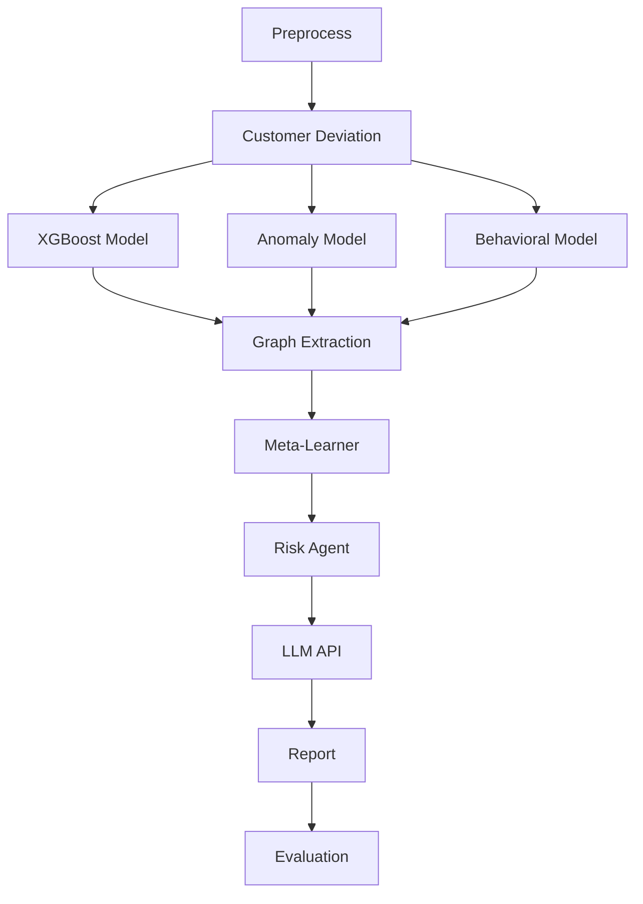

# FINDETECT

**AI-powered Anti-Money Laundering (AML) detection pipeline** that combines multiple machine learning models, customer behavior analysis, transaction graph context, and an LLM-generated explanation layer to score financial transactions and produce audit-ready risk reports.

---

## Table of Contents

1. [Overview](#overview)
2. [Key Features](#key-features)
3. [How It Works](#how-it-works)
4. [Project Structure](#project-structure)
5. [Requirements](#requirements)
6. [Installation](#installation)
7. [Usage](#usage)
8. [Evaluation Results](#evaluation-results)
9. [Configuration](#configuration)
10. [Data & Privacy](#data--privacy)
11. [Limitations & Disclaimer](#limitations--disclaimer)
12. [Contributing](#contributing)
13. [License](#license)
14. [Contact](#contact)

---

## Overview

Financial institutions and regulators must identify suspicious activity across very large volumes of transactions. Rules-based systems generate many false positives, and single-model approaches miss patterns that only appear when several signals are combined.

FINDETECT addresses this by running every transaction batch through a multi-stage pipeline:

- Several independent detection models look at the data from different angles (supervised, unsupervised, and behavioral).
- A **meta-learner** fuses their outputs into one calibrated risk score.
- A **risk agent** and an **LLM** turn the score into a human-readable explanation.
- A final **evaluation** step measures how well the pipeline performed.

The pipeline is orchestrated with [LangGraph](https://github.com/langchain-ai/langgraph), which makes each stage explicit, testable, and easy to extend.

**Intended audience:** compliance analysts, financial institutions, government and regulatory bodies, and developers/students building on the project.

---

## Key Features

- **Multi-model detection**: XGBoost (supervised), anomaly detection (unsupervised), and behavioral modeling run in parallel.
- **Customer deviation analysis**: compares each transaction against the customer's own historical behavior.
- **Graph context extraction**: adds relationship and network features between accounts.
- **Meta-learner fusion**: learns how to weight the individual models instead of relying on fixed rules; includes fusion-weight optimization.
- **Explainable output**: a locally hosted LLM (via Ollama) generates a plain-language rationale for each risk decision, keeping data on-premises.
- **Automated reporting and evaluation**: produces reports and performance metrics at the end of each run.
- **Threshold analysis**: risk scores can be exported and analyzed to choose operating thresholds.
- **Batch processing**: run a single day or all days in a dataset.
- **Web dashboard**: analysts run the pipeline from the browser, review flagged accounts, and chat with a local AI investigator about each case (FastAPI backend + HTML frontend).
- **Local analytical storage** using DuckDB and Parquet for fast processing without a separate database server.

---

## How It Works

The pipeline is defined in `LangGraph.py` as a directed graph with a parallel fan-out and fan-in.



| Stage | Purpose |
|---|---|
| **Preprocess** | Loads the prepared feature dataset (Parquet) for the selected day. |
| **Customer Deviation** | Measures how far each transaction deviates from the customer's own historical behavior. |
| **XGBoost model** | Supervised model that outputs a fraud probability per transaction. |
| **Autoencoder anomaly model** | Unsupervised neural network that scores how unusual a transaction is by its reconstruction error. |
| **Behavioral risk model** | Rule-based scoring of amount drift, frequency drift, peer-group outliers (robust MAD scaling) and short-term velocity. |
| **Graph Extraction** | Builds a daily transaction graph and adds context: exposure to high-risk accounts up to **3 hops**, **bidirectional flows** (layering indicator) and **fan-in / fan-out** patterns (money-mule indicator). Very high-degree accounts such as merchants are shielded from false seeding. |
| **Meta-Learner** | A trained stacking model that fuses the three model scores, graph features and customer-deviation features into one risk score per account per day. If the trained meta-learner is not found, the pipeline falls back to the weighted-average risk score. |
| **Risk Agent** | Applies the investigation threshold and signal filters, then sorts flagged accounts into `TIER_1_HIGH`, `TIER_2_MEDIUM` and `TIER_3_LOW` queues. |
| **LLM API** | Builds a structured case for the highest-risk accounts (top 25 per run) and drafts a Suspicious Activity Report (SAR) using a local LLM served by Ollama. The default limit is 25 reports per run because of local hardware limits; it can be raised on stronger hardware (`MAX_REPORTS` in `nodes.py`). |
| **Report** | Assembles the final results. |
| **Evaluation** | If ground-truth labels (`Is Laundering`) are present, computes precision, recall and F1 for each model and the Risk Agent. |

The three detection models run **in parallel**.

Shared data moves between stages through a custom state object (`AMLPipelineState`), which uses a `merge_dicts` reducer so that parallel model branches can safely write their results without overwriting each other.

---

## Project Structure

```
FINDETECT/
├── frontend/                        # Web dashboard (HTML): case list and AI investigation chat
├── models/                          # Trained models (incl. autoencoder_final64/)
├── Data/processed/                  # 64 input Parquet files: block_d_numerical_bucket_000 to 063 (not committed to Git)
├── outputs/                         # Pipeline results, one folder per run (generated)
├── pre_model/                       # Pre-trained / preliminary model artifacts
├── threshold_report/                # Threshold analysis outputs
├── AMLPipelineState.py              # Shared pipeline state (with merge_dicts reducer)
├── config.py                        # Central configuration
├── customer_deviation.py            # Customer behavior deviation logic
├── LangGraph.py                     # Pipeline graph definition and compilation
├── LLM.py                           # LLM integration for explanations
├── main.py                          # FastAPI backend for the web dashboard
├── make_sample.py                   # Generates sample data
├── meta_learner.py                  # Meta-learner model
├── nodes.py                         # Node implementations for each pipeline stage
├── optimize_fusion_weights.py       # Optimizes weights used to fuse model outputs
├── train_meta_learner_fixed.py      # Trains the meta-learner
├── run_full_pipeline.py             # Command-line runner (--input file and/or --date YYYY-MM-DD)
├── run_all_days.py                  # Runs the pipeline across multiple days
├── risk_scores_for_threshold_analysis.parquet  # Exported scores for threshold analysis
├── data.duckdb                      # Local DuckDB database
├── requirements.txt                 # Python dependencies
└── README.md
```

---

## Requirements

- Python 3.10 or higher *(update if you require a different version)*
- The packages listed in `requirements.txt`, including LangGraph, XGBoost, TensorFlow, DuckDB, pandas, FastAPI, Uvicorn and the `ollama` Python client
- [Ollama](https://ollama.com) installed and running locally, with a model pulled for the explanation step *(see [Configuration](#configuration))*

---

## Installation

```bash
# 1. Clone the repository
git clone https://github.com/aml-compliance-system/aml-compliance-system.git
cd aml-compliance-system

# 2. Create and activate a virtual environment
python -m venv venv
source venv/bin/activate        # Windows: venv\Scripts\activate

# 3. Install dependencies
pip install -r requirements.txt

# 4. Install Ollama (https://ollama.com) and pull the model used for explanations
ollama pull qwen2.5

dataset: [https://drive.google.com/drive/u/0/folders/15Jb5T64Ua99DMZWRbz8ptRSEMY2KBLKQ]
```


---

## Usage

### 1. Prepare the input data and models

The pipeline expects:

- **Feature dataset:** 64 Parquet files named `block_d_numerical_bucket_*.parquet` in `Data/processed/` (or another folder set with `FINDETECT_FINAL_DATA_DIR`).
- **Autoencoder package** in `models/autoencoder_final64/` containing:
  - `autoencoder_final64_fixed.keras`
  - `preprocessing_and_scoring_final64.joblib`
  - `metadata_final64.json`

The script stops with a clear error message if either is missing.

### 2. Start Ollama

Make sure the Ollama service is running and the model has been pulled (`ollama pull qwen2.5`).

### 3. Run the pipeline from the command line

Use `--input` to analyze a single Parquet file, or `--date` to analyze one day from the 64-file dataset. You can also combine them to analyze one day of a single file.

```bash
# Whole file (no date needed)
python run_full_pipeline.py --input "Data/processed/prod_sample_oct23_25.parquet"

# One day of the full 64-file dataset
python run_full_pipeline.py --date 2022-09-01

# One day of a single file
python run_full_pipeline.py --input "Data/processed/prod_sample_oct23_25.parquet" --date 2022-10-24
```

`--date` must be a real date in `YYYY-MM-DD` format that exists in your data. The script prepares the input with DuckDB, runs the full LangGraph pipeline, and saves the results.

### 4. Run across multiple days

```bash
python run_all_days.py
```

### 5. Optional utilities

```bash
python make_sample.py               # generate sample data
python train_meta_learner_fixed.py  # train the meta-learner
python optimize_fusion_weights.py   # optimize fusion weights
```

### 6. Use the pipeline programmatically

```python
from LangGraph import app

final_state = app.invoke({"final_parquet_path": "path/to/daily_file.parquet"})
risk_scores = final_state["risk_scores"]   # pandas DataFrame, one row per account/day
```

### 7. Run the web dashboard

The dashboard lets an analyst run the pipeline, review flagged accounts, and chat with an AI investigator about each case. It has two parts that run in two separate terminals, both started from the project folder.

**Terminal 1: the API (port 8000)**

```bash
uvicorn main:app --reload
```

`--reload` restarts the server when Python files change, which is convenient during development. For a deployment, run without it.

**Terminal 2: the frontend (port 5600)**

```bash
cd frontend
python -m http.server 5600
```

Then open `http://127.0.0.1:5600/`, choose the dashboard page, and click **Run Risk Agent**. Make sure Ollama is running first, since it writes the SAR drafts and answers the chat.

The dashboard analyzes `Data/processed/prod_sample_oct23_25.parquet` by default. The file is set in the dashboard page (`final_parquet_path`) and can be changed to any Parquet file with the same feature columns.

Web runs use the same preparation and output code as the command line, so the results and saved files (`risk_scores.parquet`, `sar_reports.jsonl`, `summary.json`) are identical.

| Endpoint | Purpose |
|---|---|
| `POST /pipeline/analyze` | Runs the pipeline. Body: `{"final_parquet_path": "...", "date": "YYYY-MM-DD"}` (`date` is optional). |
| `POST /chat` | Asks the local LLM questions about a flagged case. |
| `GET /case/{case_id}` | Returns the stored details and SAR draft for a flagged account. |

**Important notes**

- **Serve the frontend with `python -m http.server`, not VS Code Live Server.** Live Server (port 5500) reloads the page whenever a file in the project changes. Each run writes files to `outputs/` and `.tmp/`, so the page would reload and the cards would disappear.
- **Pick a free port.** Port 5600 is used in these instructions, but any free port works. Avoid 5500 (Live Server) and 8080 (often used by other software such as PostgreSQL).
- If `uvicorn` is not installed, run `pip install fastapi uvicorn`.

### Output

Results are written to `outputs/FINDETECT_Pipeline_Output/<run>/`, where `<run>` is the date, or the input file name when no date is given (web runs add a timestamp):

| File | Content |
|---|---|
| `risk_scores.parquet` | Risk score, risk label, investigation flag and tier for every account on that day. |
| `sar_reports.jsonl` | LLM-drafted SAR reports (one JSON record per line) for the highest-risk cases. |
| `summary.json` | Run summary: number of account/days, investigation cases, high-risk seeds and directly exposed receivers. |

---

## Evaluation Results

FINDETECT is evaluated at two levels: each detection model is scored per **transaction**, and the final Risk Agent is scored per **account/day**, which is the level at which a compliance analyst actually reviews alerts. Because the grains differ, the two tables should not be compared row by row.

Suspicious activity is extremely rare in this data (about 0.18% of transactions and 0.53% of account/days), so accuracy is not a useful metric. Precision, recall and F1 on the suspicious class are reported instead.

### Individual models (transaction level)

Decision thresholds used for evaluation: XGBoost probability >= 0.40, autoencoder anomaly score >= 0.92, behavioral score >= 0.75.

| Model | Precision | Recall | F1-Score | TP | FP | FN | TN |
|---|---|---|---|---|---|---|---|
| XGBoost | 0.0315 | 0.0476 | 0.0379 | 230 | 7,074 | 4,603 | 2,749,343 |
| Autoencoder (anomaly) | 0.0068 | 0.3296 | 0.0134 | 1,593 | 231,461 | 3,240 | 2,524,956 |
| Behavioral Risk | 0.0717 | 0.0395 | 0.0510 | 191 | 2,472 | 4,642 | 2,753,945 |

Each model captures a different trade-off. The autoencoder finds the most suspicious transactions (highest recall) but raises many false alarms, while the behavioral model is the most precise but misses most cases. No single model is sufficient on its own, which is the reason for the fusion step.

### Final Risk Agent (account/day level)

| Metric | Value |
|---|---|
| Precision | 0.1172 (11.7%) |
| Recall | 0.7462 (74.6%) |
| F1-Score | 0.2026 |
| True Positives | 3,122 |
| False Positives | 23,513 |
| False Negatives | 1,062 |
| True Negatives | 761,378 |

Of 789,075 account/days, the Risk Agent flagged 26,635 (about 3.4%) and caught 3,122 of the 4,184 truly suspicious ones. That is roughly 22 times more precise than reviewing account/days at random (base rate 0.53%), while recovering about three quarters of the suspicious activity.

### Reading these results

- The combined Risk Agent reaches far higher recall (74.6%) than any individual model (at most 33%), which shows the benefit of fusing models and graph context.
- Precision is still low in absolute terms (11.7%), so most alerts are false positives and need human review. Alert volume and precision can be traded off by adjusting the decision threshold (see `threshold_report/`).
- These figures come from one dataset and one configuration. Re-evaluate on your own data before operational use.

---

## Configuration

Thresholds, model paths, fusion weights and penalties are defined in `config.py`. Paths can also be overridden with environment variables:

| Variable | Purpose | Default |
|---|---|---|
| `FINDETECT_FINAL_DATA_DIR` | Folder with the 64 Parquet feature files | `Data/processed` |
| `AUTOENCODER_MODEL_DIR` | Folder with the autoencoder package | `models/autoencoder_final64` |
| `FINDETECT_OUTPUT_DIR` | Where results are saved | `outputs/FINDETECT_Pipeline_Output` |
| `FINDETECT_TEMP_DIR` | Temporary daily Parquet files | `.tmp/findetect_daily` |

Example (Windows PowerShell):

```powershell
$env:FINDETECT_FINAL_DATA_DIR = "D:\data\processed"
python run_full_pipeline.py --date 2022-09-01
```

The Ollama model is `qwen2.5` by default, and Ollama listens on `http://localhost:11434`. Because the LLM runs locally, no API key is required. If you add other secrets later, keep them in environment variables or a local `.env` file excluded through `.gitignore`.

---

## Data & Privacy

Financial data is highly sensitive. When deploying FINDETECT:

- Run it inside your organization's secure environment; data is stored locally in DuckDB/Parquet files.
- The LLM explanation step runs **locally through [Ollama](https://ollama.com)**, so transaction details are not sent to an external API or third-party service. This makes FINDETECT suitable for environments with strict data-residency requirements.
- The dashboard API is intended for local use. It accepts requests from any origin and any file path under your control; before exposing it on a network, restrict the allowed origins and input folders, and add authentication.
- Do not commit real customer data to the repository. Use `make_sample.py` for demos and testing.
- Follow applicable regulations for your jurisdiction (for example GDPR or local AML/KYC requirements).

---

## Limitations & Disclaimer

- FINDETECT is a **decision-support tool**. It does not replace human compliance analysts or make final determinations of illicit activity.
- Model performance depends on data quality and how closely the data matches the training data. Results should be validated on your own data before operational use.
- SAR drafts are generated for the top 25 highest-risk cases per run by default, a limit chosen for local hardware. Production deployments with more compute can raise it so that every flagged case gets a draft. All flagged cases are still saved in `risk_scores.parquet`.
- LLM-generated explanations are meant to assist review and may contain inaccuracies; they should not be treated as evidence.
- Thresholds should be tuned and approved by your compliance team.

---

## Contributing

Contributions are welcome.

1. Fork the repository
2. Create a feature branch: `git checkout -b feature/your-feature`
3. Commit your changes with clear messages
4. Push the branch and open a Pull Request

Please keep changes focused, and include tests or sample results where possible.

---

## License

This project is licensed under the **MIT License**. See the [LICENSE](LICENSE) file for details.

---

## Contact

**Team:** FINDETECT team SDAA
**Email:**
- [jawadaljabbar@gmail.com](mailto:jawadaljabbar@gmail.com)
- [shooq.otibii@gmail.com](mailto:shooq.otibii@gmail.com)
- [Dalalalsolami2d@gmail.com](mailto:Dalalalsolami2d@gmail.com)

**Repository:** [github.com/aml-compliance-system/aml-compliance-system](https://github.com/aml-compliance-system/aml-compliance-system)
